# MiPRO · Detalles de diseño

## Header de Inicio y Notificaciones · HU-1518 / HU-1579

24-11-2026

Implementación para el app: sistema visual, navegación y detalle de cada
pantalla.

**Repositorio:** <https://github.com/Jferreirofrason/Entrega-final-App-MiPRO->

El código, las capturas de este documento y los íconos están ahí, en `app/`.

**Cómo leerlo.** Cada número al margen de una captura es una fila de la tabla
que viene abajo. Las medidas están tomadas del código y del DOM a 390 px, no
son propuestas. Cuando este documento y el código no coincidan, manda el
código.

| Parte | Qué hay |
|---|---|
| 01 · Sistema visual | Tipografía, color, estados, íconos y los componentes que usan dos o más pantallas |
| 02 · Navegación | Qué pantalla es cada ruta y cuál entra en esta entrega |
| 03 · Pantallas | Una captura numerada por pantalla, con su tabla |
| 04 · Contenido | Qué dice una notificación, de dónde sale cada texto y en qué orden aparecen |

---

# 01 · Sistema visual

## 1.1 Tipografía

Dos fuentes. **Bebas Neue** en mayúsculas para los títulos de pantalla, de
grupo y de hoja. **Helvetica Neue LT Std** para todo lo demás, con Arial de
respaldo. Tamaños en px, sin escalado propio: siguen el ajuste del sistema.

Los nombres de la primera columna son **de este documento**, para poder
citarlos en las tablas. Hoy no existen como estilos con nombre: el tamaño se
escribe en cada lugar. Si se van a reusar, conviene nombrarlos de verdad.

| Nombre | Muestra | Fuente | Tamaño |
|---|---|---|---|
| `titulo/pantalla` | NOTIFICACIONES | Bebas Neue 400, mayúsculas, interletra 1 | 20 |
| `titulo/grupo` | HOY | Bebas Neue 400, mayúsculas, interletra 1 | 16 |
| `titulo/hoja` | NOTIFICACIONES | Bebas Neue 400, mayúsculas, interletra 1 | 20 |
| `titulo/confirmacion` | ¿Borrar todas las notificaciones? | Helvetica 600 | 17 / 23 |
| `saludo` | HOLA, MARÍA | Bebas Neue 400, mayúsculas, interletra 1 | 20 |
| `saludo/sub` | ¿Qué hacemos hoy en tu hogar? | Helvetica 400 | 12 |
| `avatar/inicial` | M | Helvetica 600 | 18 en el avatar de 44 · 36 en el de 88 |
| `contador` | 10 notificaciones sin leer | Helvetica 500 | 13 |
| `fila/encabezado` | Servicio · Instalación de aire | Helvetica 400 | 12 / 17 |
| `fila/titulo` | Tu cita está programada | Helvetica 500 sin leer · 400 leída | 15 / 20 |
| `fila/fecha` | 9:30 a. m. | Helvetica 400 | 12 |
| `chip/estado` | Cita programada | Helvetica 500 | 12 / 16 |
| `cuerpo/md` | Cuando tengamos información sobre tus servicios | Helvetica 400 | 14 / 20 |
| `cuerpo/sm` | Esta acción eliminará todas las notificaciones | Helvetica 400 | 13 / 19 |
| `accion/hoja` | Marcar todas como leídas | Helvetica 500 | 15 / 20 |
| `accion/detalle` | segunda línea de una acción | Helvetica 400 | 13 / 18 |
| `boton` | Borrar todas | Helvetica 500 | 13 |
| `aviso` | Borramos todas tus notificaciones | Helvetica 400 | 13 / 19 |
| `campana/contador` | 10 | Helvetica 500 | 10 |

---

## 1.2 Color

Ningún color se escribe a mano. Todos son tokens del sistema, y ese es el
único lugar donde viven. Los códigos de esta tabla están para leer, no para
copiar al código.

### Diccionario de colores

| Nombre | Código |
|---|---|
| `--primary-yellow` | `#FFEE00` |
| `--amarillo-sin-leer` | `rgba(255, 238, 0, 0.10)` |
| `--primary-black` | `#000000` |
| `--primary-white` | `#FFFFFF` |
| `--gray-80` | `#414141` |
| `--gray-60` | `#717171` |
| `--gray-40` | `#929292` |
| `--gray-20` | `#D0D0D0` |
| `--gray-8` | `#ECECEC` |
| `--gray-3` | `#F6F6F5` |
| `--info-blue` | `#336DD0` |
| `--success-green` | `#58CA8A` |
| `--error-red` | `#E05263` |
| oro oscuro | `#8A7A00` |

**El oro oscuro es el único color de esta entrega que no es un token.** Es el
texto del estado `En revisión`. El amarillo de marca no contrasta sobre
blanco, así que el chip lleva el amarillo al 20 % de fondo y la palabra en
oro. Si se queda, le corresponde un nombre propio.

### Para qué se usa cada uno

| Nombre | Para qué |
|---|---|
| `--primary-yellow` | Fondo del avatar, barra de la fila sin leer, `Deshacer` del aviso |
| `--amarillo-sin-leer` | Sombreado de la fila sin leer |
| `--primary-black` | Títulos, íconos del encabezado, punto de no leída, fondo del aviso |
| `--primary-white` | Fondo de las dos pantallas y de las hojas |
| `--gray-80` | Título de una fila leída, cuerpo de la confirmación |
| `--gray-60` | Encabezado del caso sin leer, descripción del vacío, línea de estado del menú |
| `--gray-40` | Fecha y hora, papelera, campana del vacío, encabezado del caso leído |
| `--gray-20` | Borde del avatar, borde del botón de volver, agarre de las hojas |
| `--gray-8` | Separadores de 1 pt |
| `--gray-3` | Fila al tocarla, pie de la confirmación |
| `--error-red` | Borrar todas, contador de la campana |

### Color por estado

Los cinco salen de un solo mapa de estados, **el mismo que usa el
historial**: un estado no puede verse de dos colores según desde dónde se lo
mire.

| Estado | Chip | Ícono | Fondo del chip | Texto e ícono |
|---|---|---|---|---|
| Solicitud recibida | 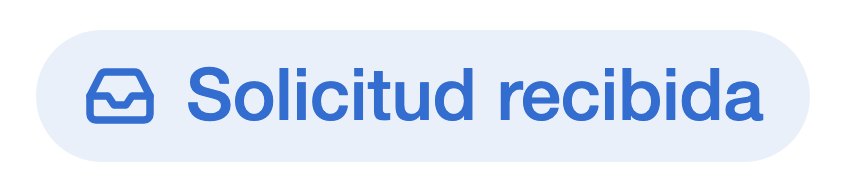 |  08 `Inbox` | `rgba(51, 109, 208, 0.1)` | `--info-blue` `#336DD0` |
| En revisión | 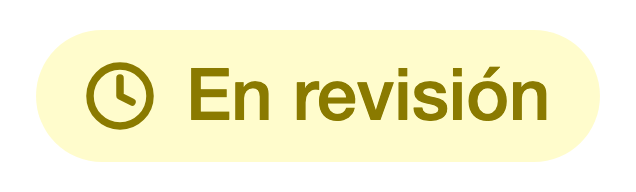 |  09 `Clock` | `rgba(255, 238, 0, 0.2)` | oro oscuro `#8A7A00` |
| Cita programada | 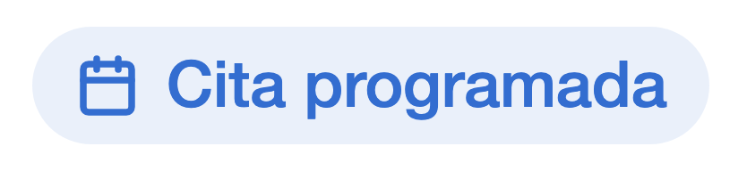 |  10 `Calendar` | `rgba(51, 109, 208, 0.1)` | `--info-blue` `#336DD0` |
| Completada | 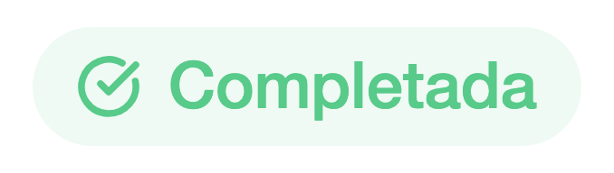 |  11 `CheckCircle` | `rgba(88, 202, 138, 0.1)` | `--success-green` `#58CA8A` |
| Cancelada | 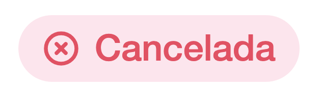 |  12 `XCircle` | `rgba(226, 3, 77, 0.1)` | `--error-red` `#E05263` |

Los chips de esa columna son la muestra real, recortada de la pantalla: ese es
el color y ese es el ícono. Cada estado se reconoce por **tres cosas a la vez**
(color, ícono y palabra), nunca por el color solo.

| Estado | Clave visual |
|---|---|
| Solicitud recibida | `solicitud recibida` |
| En revisión | `en progreso` |
| Cita programada | `agendado` |
| Completada | `finalizado` |
| Cancelada | `cancelado` |

**`Solicitud recibida` y `Cita programada` comparten el azul.** Se distinguen
por el ícono y por la palabra, no por el color.

---

## 1.3 Estados de los controles

No hay estado deshabilitado en esta entrega: un control que no tiene sentido
no se muestra, no se apaga. El menú entero desaparece con la bandeja vacía, y
`Marcar todas como leídas` desaparece cuando no queda ninguna sin leer.

| Control | Reposo | Al tocar |
|---|---|---|
| Fila de notificación | Transparente o `--amarillo-sin-leer` | Fondo `--gray-3`, con transición de color |
| Papelera de la fila | Ícono `--gray-40` | Opacidad 60 % |
| Volver | Blanco, borde 1 pt `--gray-20`, radio 10 | Opacidad 80 % |
| Tres puntos | Sin fondo ni borde | Opacidad 80 % |
| Acción de la hoja | Texto `--primary-black` | Fondo `--gray-3` |
| `Cancelar` | Blanco, borde 1 pt `--gray-20`, radio 10 | Opacidad |
| `Borrar todas` | Fondo `--error-red`, texto blanco, radio 10 | Opacidad |

**Todo lo que se toca mide 44 px de lado como mínimo.** Las dos pantallas se
midieron en el DOM para comprobarlo.

---

## 1.4 Íconos

Los 12 íconos de esta entrega son **assets propios**: un archivo SVG por
ícono, guardados en el repositorio de la entrega,
en **`app/docs/iconos/`**, igual que las fotos de las categorías:

<https://github.com/Jferreirofrason/Entrega-final-App-MiPRO-/tree/main/app/docs/iconos>

Cada archivo va a **24 × 24, trazo 2 y color heredado**. El tamaño y el color
de cada uso están más abajo, en la tabla de usos: el mismo archivo sirve para
el negro del encabezado y para el gris de la papelera.

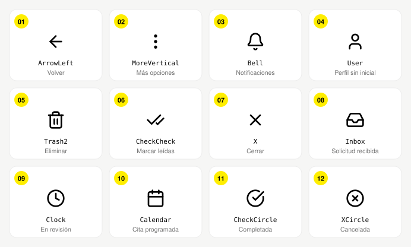{: .lamina }

| # | Ícono | Nombre | Archivo |
|---|---|---|---|
| 01 |  | `ArrowLeft` | `01-arrow-left.svg` |
| 02 |  | `MoreVertical` | `02-ellipsis-vertical.svg` |
| 03 |  | `Bell` | `03-bell.svg` |
| 04 |  | `User` | `04-user.svg` |
| 05 |  | `Trash2` | `05-trash-2.svg` |
| 06 |  | `CheckCheck` | `06-check-check.svg` |
| 07 |  | `X` | `07-x.svg` |
| 08 |  | `Inbox` | `08-inbox.svg` |
| 09 |  | `Clock` | `09-clock.svg` |
| 10 |  | `Calendar` | `10-calendar.svg` |
| 11 |  | `CheckCircle` | `11-circle-check-big.svg` |
| 12 |  | `XCircle` | `12-circle-x.svg` |

**El número manda.** Es el mismo en la lámina, en el nombre del archivo y en
la columna «Icono» de las tablas de la Parte 03. Un ícono se pide por su
número, no por su descripción.

**Los archivos son la fuente.** Si un ícono cambia, se cambia el archivo: la
lámina y las tablas de este documento lo muestran cambiado sin tocar nada
más.

### Tamaño y trazo

| Trazo | Dónde | Por qué |
|---|---|---|
| 2.5 | El ícono de 12 del chip de estado | A ese cuerpo, con trazo 2 se desarma |
| 2 | Todo lo demás | Es el trazo base |
| 1.5 | La campana de 48 del vacío | A ese tamaño un trazo grueso pesa más que el texto |

| Ícono | # | Dónde se ve | Tamaño | Trazo | Color |
|---|---|---|---|---|---|
|  | 03 `Bell` | Campana del encabezado del Inicio | 22 | 2 | `--primary-black` |
|  | 04 `User` | Avatar, cuando no hay inicial válida | la mitad del círculo: 22 en el avatar de 44 | 2 | `--primary-black` |
|  | 01 `ArrowLeft` | Volver, en la barra superior | 20 | 2 | `--primary-black` |
|  | 02 `MoreVertical` | Más opciones, en la barra superior | 20 | 2 | `--primary-black` |
|  | 05 `Trash2` | Eliminar, en la fila | 16 | 2 | `--gray-40` |
|      | 08 a 12 | Chip de estado, en la fila | 12 | 2.5 | el del estado, ver 1.2 |
|  | 03 `Bell` | Bandeja vacía | 48 | 1.5 | `--gray-40` |
|  | 06 `CheckCheck` | Marcar todas como leídas, en el menú | 20 | 2 | `--primary-black` |
|  | 06 `CheckCheck` | Línea de estado, en el menú | 20 | 2 | `--gray-60` |
|  | 05 `Trash2` | Borrar todas, en el menú | 20 | 2 | `--error-red` |
|  | 07 `X` | Cerrar el menú de acciones | 18 | 2 | `--gray-60` |
|  | 07 `X` | Cerrar la confirmación de borrado | 18 | 2 | `--gray-60` |

**El ícono del estado no se elige en la pantalla.** La fila lo toma del mapa
de estados, que da ícono, color y fondo juntos. Por eso un estado se ve igual
en la bandeja y en el historial, y por eso se cambia en un solo lugar.

---

## 1.5 Componentes

Controles que usan dos o más pantallas. Los propios de una sola se definen en
su sección de la Parte 03.

### Avatar de perfil

Un solo componente, `AvatarDePerfil`, para el encabezado del Inicio y para
Perfil. Recibe un solo parámetro, `tamano`. Todo lo demás se deriva de ahí.

| Parte | Componente | Icono | Fuente | Color |
|---|---|---|---|---|
| Contenedor | Círculo · 44 en el Inicio, 88 en Perfil · borde 1 pt | — | — | `--primary-yellow` · borde `--gray-20` |
| Inicial | Una letra, nunca dos · cuerpo `round(tamano × 0.41)` · interlínea 1 | — | `avatar/inicial` | `--primary-black` |
| Sin inicial | Ícono a `round(tamano × 0.5)` | 04 | — | `--primary-black` |
| Botón que lo contiene | 44 × 44 · abre Perfil | — | — | — |

- **Por qué Helvetica y no Bebas:** es una letra suelta, no un título. Con
  Bebas se lee como un logotipo.
- **Por qué el cuerpo se calcula:** para no tener un número suelto por cada
  uso. Si aparece un tercer tamaño, la letra acompaña sola.
- **No hay fotos, ni emojis, ni dos iniciales.** El componente no acepta una
  URL de imagen: no es un parámetro que se pueda pasar por error.

La regla de la inicial está escrita una sola vez, y con pruebas:

1. Descarta los espacios del principio. `"  maría"` da `M`.
2. Toma el primer carácter, nunca dos. `"María López"` da `M`.
3. Pasa a mayúscula respetando el español. `"álvaro"` da `Á`, `"ñusta"` da
   `Ñ`, `"óscar"` da `Ó`.
4. Si ese carácter no es una letra, devuelve `null`. `"123"`, `"#maría"` y
   `"_"` no dan inicial.
5. Sin nombre devuelve `null`, y entonces se muestra el ícono 04.

### Barra superior

| Parte | Componente | Icono | Fuente | Color |
|---|---|---|---|---|
| Contenedor | Barra fija arriba · padding 20 / 24 / 16 · sombra `0 2px 10px rgba(0,0,0,0.05)` | — | — | `--primary-white` |
| Volver | Botón 44 × 44 · radio 10 · borde 1 pt | 01 | — | ícono `--primary-black` · borde `--gray-20` |
| Título | 1 línea con elipsis · a 12 del botón | — | `titulo/pantalla` | `--primary-black` |
| Más opciones | Botón 44 × 44 · sin fondo ni borde · al borde derecho | 02 | — | `--primary-black` |

### Fila de notificación

La fila entera es el botón. **Sin chevron y sin ícono por tipo:** lo dice el
texto.

| Parte | Componente | Icono | Fuente | Color |
|---|---|---|---|---|
| Contenedor | Alto 98 con una línea de título · separador inferior 1 pt | — | — | sin leer `--amarillo-sin-leer` · leída transparente |
| Barra de sin leer | 3 pt al borde izquierdo, alto completo | — | — | `--primary-yellow` |
| Zona que abre | 346 × 98 · padding 14 / 4 / 14 / 24 · rejilla `8px 1fr` con hueco 10 | — | — | al tocar `--gray-3` |
| Punto de sin leer | 8 × 8 · círculo · a 6 del tope | — | — | `--primary-black` · leída transparente |
| Encabezado del caso | 1 línea con elipsis | — | `fila/encabezado` | sin leer `--gray-60` · leída `--gray-40` |
| Título | Hasta 2 líneas · a 3 del encabezado | — | `fila/titulo` | sin leer `--primary-black` · leída `--gray-80` |
| Fecha y hora | A la derecha, en la línea base del título | — | `fila/fecha` | `--gray-40` |
| Chip de estado | A 7 del título · ver abajo | 08 a 12 | `chip/estado` | el del estado |
| Papelera | 44 de ancho · alto completo · a 15 del tope | 05 | — | `--gray-40` |
| Separador | 1 pt entre filas, no antes de la primera | — | — | `--gray-8` |

> ⚠️ **Mirar el sombreado con la bandeja entera sin leer.** El amarillo marca
> una fila contra las demás. Cuando ninguna se abrió aparece en todas y deja
> de señalar, que es lo que se ve en la captura de 3.2, con las diez sin leer.
> Se implementó así porque negocio lo pidió. Queda para revisar con bandejas
> reales, mezcladas.

**Dónde va el sombreado:** en el contenedor de la fila, no en la zona que
abre. Así llega hasta la papelera y la fila se lee como una sola pieza.

### Chip de estado

| Parte | Componente | Icono | Fuente | Color |
|---|---|---|---|---|
| Contenedor | Alto automático · padding 3 / 8 · radio 999 · hueco 5 | — | — | el fondo del estado, ver 1.2 |
| Ícono | 12 · trazo 2.5 | 08 a 12 | — | el del estado |
| Palabra | Siempre escrita, nunca solo el color | — | `chip/estado` | el del estado |

Los cinco, como se ven:


**El color acompaña, no informa solo.** El chip lleva siempre la palabra del
estado, además del color y del ícono.

### Hoja de acciones

La misma hoja que usa el resto de la app.

| Parte | Componente | Icono | Fuente | Color |
|---|---|---|---|---|
| Fondo | Capa que cierra al tocar | — | — | `rgba(0, 0, 0, 0.45)` |
| Hoja | Anclada abajo · radio superior 24 · alto máximo 80 % · sombra `0 -8px 30px rgba(0,0,0,0.15)` | — | — | `--primary-white` |
| Agarre | 48 × 6 · radio completo | — | — | `--gray-20` |
| Título | Con la X al lado · borde inferior 1 pt | — | `titulo/hoja` | `--primary-black` · borde `--gray-8` |
| Cerrar | Botón 36 × 36 | 07 | — | `--gray-60` |
| Acción | Alto mínimo 52 · padding 8 / 24 · hueco 14 · ícono en columna de 24 | 05 06 | `accion/hoja` | normal `--primary-black` · destructiva `--error-red` |
| Línea de estado | Misma fila, sin acción: no se toca | 06 | `accion/hoja` | `--gray-60` |

### Hoja de confirmación

| Parte | Componente | Icono | Fuente | Color |
|---|---|---|---|---|
| Fondo | Capa que cierra al tocar | — | — | `rgba(0, 0, 0, 0.45)` |
| Hoja | Anclada abajo · radio superior 24 · alto máximo 90 % | — | — | `--primary-white` |
| Agarre | 48 × 6 · radio completo | — | — | `--gray-20` |
| Título | Hasta 2 líneas · con la X al lado | — | `titulo/confirmacion` | `--primary-black` |
| Texto | Dice qué se pierde y que no se recupera | — | `cuerpo/sm` | `--gray-80` |
| Pie | Dos botones · borde superior 1 pt | — | — | fondo `--gray-3` · borde `--gray-8` |
| Secundaria | Radio 10 · padding 12 / 18 · alto mínimo 44 | — | `boton` | blanca, borde `--gray-20`, texto `--primary-black` |
| Destructiva | Radio 10 · padding 12 / 18 · alto mínimo 44 | — | `boton` | `--error-red` con texto `--primary-white` |

Se cierra con `Cancelar`, con la X, tocando afuera o con Escape.

### Aviso

| Parte | Componente | Icono | Fuente | Color |
|---|---|---|---|---|
| Contenedor | Flotante abajo, centrado · a 16 del borde seguro · radio 12 · padding 10 / 12 / 10 / 16 · hueco 16 | — | — | `--primary-black` |
| Texto | 1 línea | — | `aviso` | `--primary-white` |
| `Deshacer` | Alto mínimo 36 · solo cuando la acción se puede deshacer | — | `aviso` peso 500 | `--primary-yellow` |

| Aviso | Dura | Lleva `Deshacer` |
|---|---|---|
| `Notificación eliminada` | 6 s | Sí |
| `Borramos todas tus notificaciones` | 4 s | No, porque no se puede deshacer |

---

# 02 · Navegación

| Pantalla | Ruta | En esta entrega |
|---|---|---|
| Inicio | `/` | 3.1, solo el encabezado |
| Notificaciones | `/notificaciones` | 3.2 |
| Bandeja vacía | `/notificaciones` | 3.3 |
| Menú de acciones | `/notificaciones` | 3.4 |
| Confirmar borrado | `/notificaciones` | 3.5 |
| Detalle de la notificación | `/notificaciones` | 3.6, a confirmar |
| Perfil | `/perfil` | Destino del avatar, sin cambios |
| Detalle del servicio | `/servicios/{id}` | Destino de la fila, sin cambios |
| Detalle del reclamo | `/reclamos/{id}` | Destino de la fila, sin cambios |

Todas las rutas van con `#`: el router es `createHashRouter`.

**No se tocan Servicios, Garantía, Perfil, Productos ni la barra inferior.**

---

# 03 · Pantallas

Cada número al margen de la captura es una fila de la tabla.

## 3.1 Inicio · encabezado

Lo único que cambia del Inicio. La foto de perfil se reemplaza por la inicial
del nombre sobre amarillo, y el avatar es el acceso a Perfil.

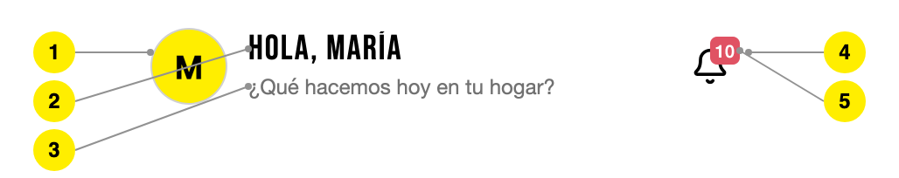{: .detalle }

| # | Elemento | Componente | Icono | Fuente | Color |
|---|---|---|---|---|---|
| 1 | Avatar | Avatar de perfil | 04 si no hay inicial | `avatar/inicial` | `--primary-yellow` |
| 2 | «Hola, María» | Encabezado del Inicio | — | `saludo` | `--primary-black` |
| 3 | «¿Qué hacemos hoy en tu hogar?» | Encabezado del Inicio | — | `saludo/sub` | `--gray-60` |
| 4 | Campana | Botón 44 × 44 | 03 | — | `--primary-black` |
| 5 | Contador sin leer | Pastilla 16 de alto · radio 4 · padding 0 / 3 | — | `campana/contador` | `--error-red` con texto `--primary-white` |

El avatar es `aria-hidden`: lo que se anuncia es el botón que lo contiene.

| Nombre | Rótulo del botón |
|---|---|
| `"María"` | `Perfil de María` |
| `"  María López  "` | `Perfil de María López` |
| sin nombre | `Mi perfil` |

---

## 3.2 Notificaciones

Raíz de la bandeja. Lista las notificaciones agrupadas por fecha y ofrece las
acciones de la bandeja. Al tocar una fila se abre el detalle del caso y la
notificación queda leída.

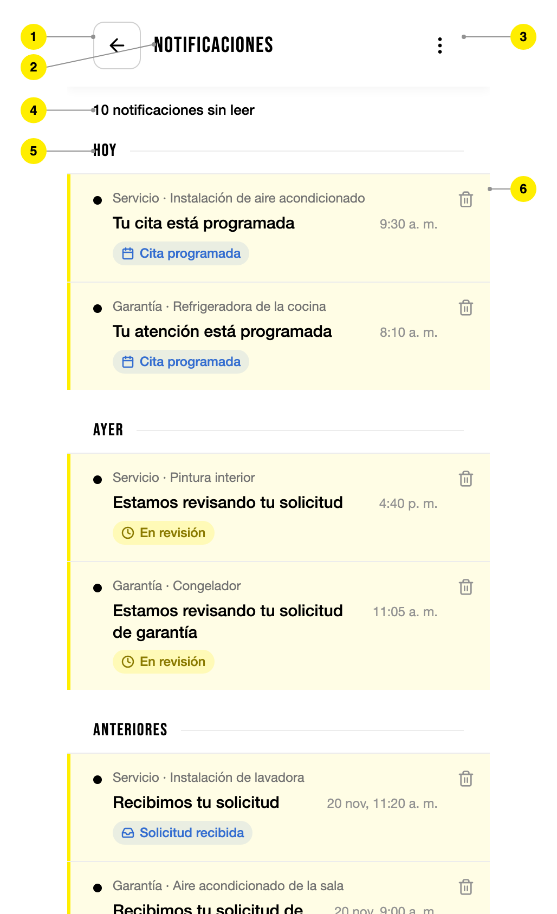{: .numerada }

| # | Elemento | Componente | Icono | Fuente | Color |
|---|---|---|---|---|---|
| 1 | Volver | Barra superior | 01 | — | `--primary-black` |
| 2 | Título «Notificaciones» | Barra superior | — | `titulo/pantalla` | `--primary-black` |
| 3 | Más opciones | Barra superior | 02 | — | `--primary-black` |
| 4 | «10 notificaciones sin leer» | Contador · padding 12 / 24 / 2 | — | `contador` | `--primary-black` |
| 5 | «Hoy», «Ayer», «Anteriores» | Encabezado de grupo · línea al lado | — | `titulo/grupo` | texto `--primary-black` · línea `--gray-8` |
| 6 | Una notificación | Fila de notificación | 05 08 a 12 | ver 1.5 | ver 1.5 |

La captura muestra los primeros 844 px. Lo que sigue hacia abajo son más
filas iguales.

### El contador

Aparece **solo con pendientes**. Con la bandeja al día no hay nada que contar,
y «0 notificaciones sin leer» es ruido.

| Sin leer | Texto |
|---|---|
| 1 | `1 notificación sin leer` |
| 2 o más | `10 notificaciones sin leer` |
| 0 | no se muestra |

### Fecha y hora

| Grupo | Qué muestra |
|---|---|
| Hoy y Ayer | Solo la hora: `9:30 a. m.` El grupo ya dice el día |
| Anteriores | Las dos: `16 nov, 11:20 a. m.` |

### La fila, en detalle

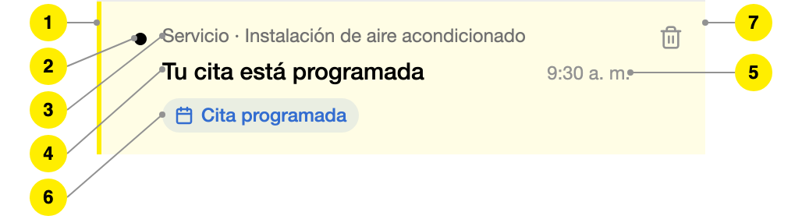{: .detalle }

| # | Elemento | Componente | Icono | Fuente | Color |
|---|---|---|---|---|---|
| 1 | Barra y sombreado de sin leer | Fila de notificación | — | — | barra `--primary-yellow` · fondo `--amarillo-sin-leer` |
| 2 | Punto de sin leer | 8 × 8 · círculo | — | — | `--primary-black` |
| 3 | «Servicio · Instalación de aire acondicionado» | Fila de notificación | — | `fila/encabezado` | `--gray-60` |
| 4 | «Tu cita está programada» | Fila de notificación | — | `fila/titulo` | `--primary-black` |
| 5 | «9:30 a. m.» | Fila de notificación | — | `fila/fecha` | `--gray-40` |
| 6 | «Cita programada» | Chip de estado | 10 | `chip/estado` | `--info-blue` |
| 7 | Eliminar | Botón 44 de ancho | 05 | — | `--gray-40` |

Cuando el texto no entra en la fila, el detalle completo se lee en un modal.
Está en 3.6.

La de garantía es la misma fila: lo único que cambia es la palabra del
encabezado y el título.

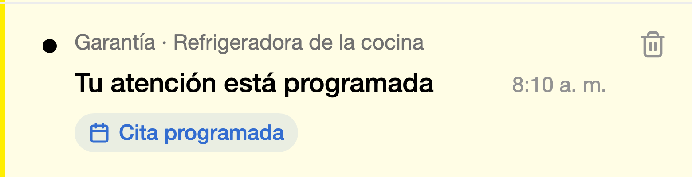

### Leída y sin leer

| | Sin leer | Leída |
|---|---|---|
| Fondo de la fila | `--amarillo-sin-leer` | transparente |
| Barra al borde | 3 pt `--primary-yellow` | sin barra |
| Punto | `--primary-black` | sin punto |
| Encabezado del caso | `--gray-60` | `--gray-40` |
| Título | `--primary-black`, peso 500 | `--gray-80`, peso 400 |

**Sin notificación prioritaria.** El amarillo marca lo que no se abrió, no una
fila destacada. Manda la fecha.

---

## 3.3 Notificaciones · bandeja vacía

Campana, dos líneas de texto, centrado. **Sin botón.**

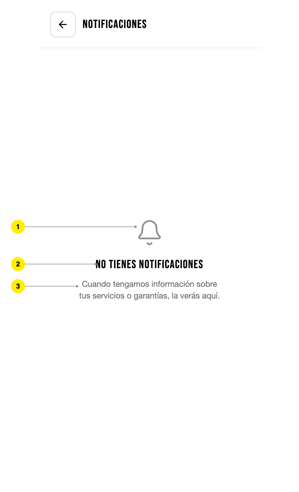{: .numerada }

| # | Elemento | Componente | Icono | Fuente | Color |
|---|---|---|---|---|---|
| 1 | Campana | Ícono 48 · trazo 1.5 | 03 | — | `--gray-40` |
| 2 | «No tienes notificaciones» | Título del vacío · a 16 del ícono | — | `titulo/pantalla` | `--primary-black` |
| 3 | «Cuando tengamos información sobre tus servicios o garantías, la verás aquí.» | Texto del vacío · a 8 del título · hasta 32 caracteres por línea | — | `cuerpo/md` | `--gray-60` |

| | |
|---|---|
| Posición | Centrado en el espacio que queda debajo del encabezado |
| Rol | `role="status"` |
| Qué desaparece | El contador y el botón de tres puntos. Queda la flecha de volver y el título |

**Sin CTA, sin ilustración, sin emojis.** Una bandeja vacía no es un callejón
ni una falla: es que está todo al día. No hay nada que ir a hacer.

---

## 3.4 Notificaciones · menú de acciones

Se abre con los tres puntos del encabezado. Dos acciones, y solo cuando tienen
sentido.

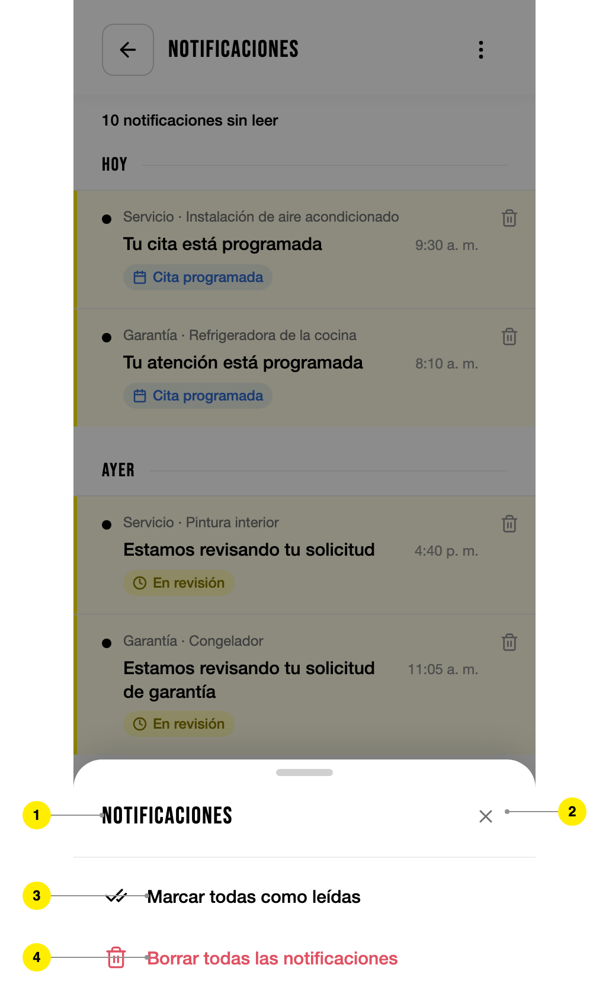{: .numerada }

| # | Elemento | Componente | Icono | Fuente | Color |
|---|---|---|---|---|---|
| 1 | Título «Notificaciones» | Hoja de acciones | — | `titulo/hoja` | `--primary-black` |
| 2 | Cerrar | Hoja de acciones | 07 | — | `--gray-60` |
| 3 | «Marcar todas como leídas» | Acción de la hoja | 06 | `accion/hoja` | `--primary-black` |
| 4 | «Borrar todas las notificaciones» | Acción de la hoja, destructiva | 05 | `accion/hoja` | `--error-red` |

| Opción | Cuándo aparece |
|---|---|
| `Marcar todas como leídas` | Solo si hay al menos una sin leer |
| `Listo, no te queda ninguna sin leer` | En su lugar cuando no queda ninguna sin leer. **No es un control:** es una línea de estado, gris y sin acción |
| `Borrar todas las notificaciones` | Si hay al menos una notificación |
| El menú entero | Solo si hay al menos una notificación |

> La línea de estado es una decisión de esta implementación, no un pedido de
> la historia. Sin ella el menú se abre con una sola opción, y esa opción es
> la destructiva.

---

## 3.5 Notificaciones · confirmar borrado

Borrar todas **sí** pide confirmación, porque no hay vuelta atrás. Eliminar
una, no.

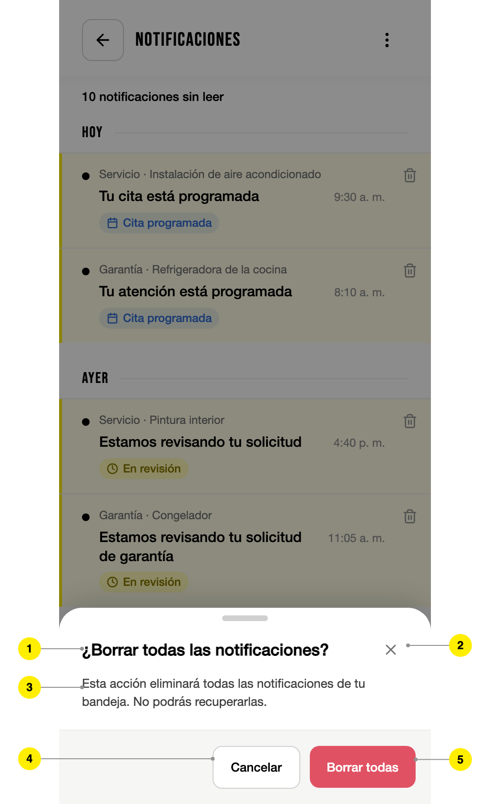{: .numerada }

| # | Elemento | Componente | Icono | Fuente | Color |
|---|---|---|---|---|---|
| 1 | «¿Borrar todas las notificaciones?» | Hoja de confirmación | — | `titulo/confirmacion` | `--primary-black` |
| 2 | Cerrar | Hoja de confirmación | 07 | — | `--gray-60` |
| 3 | «Esta acción eliminará todas las notificaciones de tu bandeja. No podrás recuperarlas.» | Hoja de confirmación | — | `cuerpo/sm` | `--gray-80` |
| 4 | «Cancelar» | Botón secundario | — | `boton` | blanco con borde `--gray-20` |
| 5 | «Borrar todas» | Botón destructivo | — | `boton` | `--error-red` con texto `--primary-white` |

Al confirmar:

- La bandeja queda vacía y aparece el estado vacío de 3.3.
- Sale el aviso `Borramos todas tus notificaciones`, que se va solo a los 4
  segundos y **no lleva `Deshacer`**.

**No hay borrado de un toque.** Eliminar una sola, en cambio, no pide
confirmación: muestra `Notificación eliminada` con `Deshacer` durante 6
segundos. Para una acción chica, en vez de frenar antes se puede volver atrás
después.

---

## 3.6 Notificaciones · detalle de la notificación

> ⚠️ **Esta pantalla no está en el prototipo.** La captura es de la versión
> actual de la app, que negocio pasó como referencia. Las medidas de abajo
> están **derivadas de esa captura, no medidas en pantalla**, y por eso van
> marcadas con ≈. Todo lo demás de este documento sí está medido. Antes de
> construirlo hay que cerrar los puntos del final de esta sección.

Cuando el texto de la notificación no entra en la fila, la fila lo corta con
puntos suspensivos y el texto completo se lee acá. **Es para leer, no para
navegar:** se abre, se lee y se cierra en el mismo lugar.

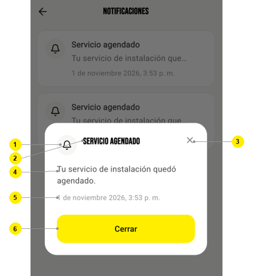{: .numerada }

| # | Elemento | Componente | Icono | Fuente | Color |
|---|---|---|---|---|---|
| 1 | Ícono del tipo | Círculo ≈ 38 · glifo ≈ 20 | 03 | — | fondo `--gray-3` · glifo `--primary-black` |
| 2 | Título del estado | En mayúsculas, a 12 del ícono | — | `titulo/hoja` | `--primary-black` |
| 3 | Cerrar | Botón 44 × 44 al borde derecho | 07 | — | `--gray-60` |
| 4 | Texto completo | Sin corte, crece hacia abajo | — | `cuerpo/md` | `--primary-black` |
| 5 | Fecha y hora | Día, mes, año y hora | — | `cuerpo/sm` | `--gray-40` |
| 6 | «Cerrar» | Botón primario · ancho completo · alto ≈ 48 · radio ≈ 14 | — | `boton` | `--primary-yellow` con texto `--primary-black` |

### La tarjeta

| | |
|---|---|
| Ancho | ≈ 330, centrada, a ≈ 30 de cada borde |
| Radio | ≈ 24 |
| Fondo de la tarjeta | `--primary-white` |
| Fondo de atrás | Capa oscura sobre la bandeja, que queda visible |
| Alto | Lo que pida el texto |

### Cómo se comporta

| | |
|---|---|
| Qué lo abre | Tocar la fila |
| Cómo se cierra | El botón `Cerrar`, la X, tocar afuera y Escape |
| Qué pasa al cerrar | Vuelve a la bandeja, en el mismo lugar. No navega a ningún otro lado |
| Qué muestra la fila | El mensaje a una línea, cortado con puntos suspensivos |
| Qué muestra el modal | El mensaje entero, sin corte |

**Dos salidas para lo mismo.** La X y el botón `Cerrar` hacen exactamente lo
mismo. El botón está porque es la acción esperada al terminar de leer y
porque la X sola, arriba a la derecha, es un blanco chico.

### Lo que hay que cerrar antes de construirlo

1. **A partir de cuándo se corta.** Hoy la fila corta a una línea. Falta
   definir si el corte es por líneas o por caracteres, y qué pasa con un
   texto corto que entra entero: si igual abre el modal o no abre nada.
2. **Qué pasa con el detalle del caso.** En el prototipo, tocar la fila
   **navega al servicio o al reclamo**. Si ahora abre este modal, hay que
   decidir si el acceso al caso se pierde, si el modal suma un segundo botón
   para ir al caso, o si conviven las dos cosas.
3. **El título.** En la captura el título del modal y el de la fila son el
   mismo texto. Conviene confirmar que siempre lo son: si no, hace falta un
   campo más en el modelo de la notificación.
4. **La fecha.** La fila de la captura muestra la fecha larga siempre. El
   prototipo agrupa por Hoy, Ayer y Anteriores y muestra solo la hora en los
   dos primeros. Hay que elegir uno de los dos criterios para toda la
   pantalla.

---

# 04 · Contenido

## 4.1 Qué es una notificación

Una notificación avisa que una solicitud **cambió de estado**. Nada más.

Los estados son **los mismos** que ya usan el historial y los detalles. No hay
vocabulario paralelo para la bandeja.

```
Solicitud recibida · En revisión · Cita programada · Completada · Cancelada
```

### Qué se retiró

| Se fue | Motivo |
|---|---|
| `Tu visita es mañana` | Es un recordatorio, no un cambio de estado. Nadie define hoy cuándo se dispara |
| `Técnico asignado` | El modelo no emite la asignación. Salía de una fijación |
| `Actualizamos tu reclamo` | No dice qué cambió. Lo reemplaza el estado concreto |
| Encuestas y calificaciones | No son un cambio de estado |
| La notificación prioritaria | La daba el recordatorio de visita. Sin él, ningún estado pesa más que otro |

Vuelven cuando se defina quién las emite y cuándo.

## 4.2 La matriz de títulos

Es **cerrada**: no hay título por defecto ni armado con plantilla. Un estado
sin texto definido no compila, y eso es lo que impide notificarlo.

**Servicio**

| Estado | Título |
|---|---|
| Solicitud recibida | Recibimos tu solicitud |
| En revisión | Estamos revisando tu solicitud |
| Cita programada | Tu cita está programada |
| Completada | Tu servicio fue completado |
| Cancelada | Tu solicitud fue cancelada |

**Garantía**

| Estado | Título |
|---|---|
| Solicitud recibida | Recibimos tu solicitud de garantía |
| En revisión | Estamos revisando tu solicitud de garantía |
| Cita programada | Tu atención está programada |
| Completada | Tu solicitud fue completada |
| Cancelada | Tu solicitud fue cancelada |

**Por qué las dos columnas no dicen lo mismo:** en garantía la persona pidió
ayuda por garantía, no «un servicio». La notificación tiene que sonar a lo que
pidió.

## 4.3 Servicio o garantía, siempre en texto

| Tipo de caso | Nombre del caso | Encabezado |
|---|---|---|
| Servicio | Instalación de aire acondicionado | `Servicio · Instalación de aire acondicionado` |
| Garantía | Refrigeradora Samsung | `Garantía · Refrigeradora Samsung` |

- No alcanza con el ícono ni con el color: un ícono se interpreta y un color
  no se lee en voz alta.
- El nombre del caso sale del **mismo servicio o reclamo al que la fila ya
  navega**. No es un campo nuevo.
- Si el servicio cambia de nombre, la bandeja lo refleja sola.

## 4.4 El modelo

```ts
interface NotificacionCliente {
  id: string;
  tipoCaso: "servicio" | "garantia";
  estado: EstadoDeSolicitud;   // uno de los cinco
  fecha: string;               // ISO con hora
  servicioId?: string;         // uno de los dos, nunca los dos
  reclamoId?: string;
}
```

**El título no se guarda.** Se deriva de `tipoCaso` más `estado`. Un cambio de
copy se hace en un solo lugar y no deja notificaciones viejas con el texto
anterior.

## 4.5 Orden y agrupación

- Grupos **Hoy, Ayer, Anteriores**, en ese orden. Los vacíos no se muestran.
- Dentro de cada grupo, **la más reciente arriba**.
- Nada más. Ya no hay prioridad.

## 4.6 Terminología y accesibilidad

La palabra es **`notificaciones`**, en la app y en el código. `novedades` se
retiró de las dos pantallas de esta entrega.

> ⚠️ **`novedades` sigue viva en Garantía.** No es alcance de esta HU, así que
> no se tocó.

| Elemento | Qué se anuncia |
|---|---|
| Avatar del Inicio | `Perfil de María`, o `Mi perfil` sin nombre |
| Campana | `Notificaciones, 10 sin leer`, o `Notificaciones` sin pendientes |
| Fila | `Ver Instalación de aire acondicionado` |
| Papelera | `Eliminar Tu cita está programada` |
| Tres puntos | `Más opciones`, con `aria-haspopup="dialog"` |
| Bandeja vacía | `role="status"` |
| Avisos | `role="status"` |

---

**Cuando este documento y el código no coincidan, manda el código.**
