# MiPRO — Detalles de diseño de la app

| | |
|---|---|
| **Actualizado** | 22 de septiembre de 2026 |
| **Versión del documento** | 1.0 |
| **Repositorio** | `Jferreirofrason/AppMiPRO` (privado) |
| **Rama analizada** | `main`, commit `10ff9b2` más el commit local `3f49c3e` de ajustes de copy |
| **App desplegada** | https://app-mipro-app.vercel.app |
| **Carpeta local analizada** | `~/Downloads/AppMiPRO` |

---

## 1. Propósito y alcance

Este documento describe **lo que la app ya tiene implementado**, para que desarrollo, QA y diseño trabajen sobre la misma referencia.

### Qué cubre

- El sistema visual: tipografía, color, espaciado, radios, bordes e íconos, tomados de `src/styles/theme.css` y de los estilos en línea de cada componente.
- Los componentes compartidos que existen hoy, con su archivo, sus variantes y sus estados.
- La navegación y las rutas tal como están declaradas en `src/app/routes.tsx`.
- El detalle de cada pantalla implementada, con captura y tabla de elementos.
- Las reglas funcionales que se ven en la interfaz.
- El inventario de textos de interfaz y dónde vive cada uno.

### Qué NO cubre

- **Integraciones reales.** No hay backend: los datos salen de fixtures en `src/app/data/` y el estado de sesión vive en `sessionStorage`. Nada persiste entre recargas salvo lo que se indica.
- **Reglas de operación que no se ven en la interfaz** (SLA, asignación de técnicos, matriz de cobertura de garantía).
- **Decisiones de backend**: modelo de datos productivo, autenticación real, notificaciones push.
- **Contenido no implementado**: fotos productivas del PIM, catálogo definitivo de estados de caso, textos legales finales.

### Fuente de verdad

Si este documento y el código no coinciden, vale el código. Los archivos que hay que leer están listados en la sección 11.

**Sobre las capturas.** Salen de la app desplegada, sin retocar: 375 px de ancho, factor de escala 2 y el alto exacto de cada pantalla. Se toman con movimiento reducido, para que las animaciones de entrada no queden a mitad de camino, y esperando a que carguen todas las imágenes. Se regeneran con `node docs/capturar.mjs`.

---

## 2. Fundamentos visuales

### 2.1 Tipografía

Dos familias, declaradas en `src/styles/fonts.css`:

| Familia | Cómo se carga | Para qué |
|---|---|---|
| **Bebas Neue** | Google Fonts (`@import`) | Títulos. Siempre en caja alta, con `letter-spacing: 1px` |
| **Helvetica Neue LT Std** | `local()` con fallback a Arial | Toda la interfaz y el cuerpo de texto |

⚠️ **Pendiente de definición.** Helvetica Neue LT Std se carga con `local()`: si la máquina de la persona no la tiene instalada, cae a Arial. El `@font-face` declara solo los pesos 400 y 500. No hay archivos de fuente en el repositorio. Para producción hay que decidir si se licencia y se sirve la fuente o se adopta una alternativa. Archivo: `src/styles/fonts.css`.

#### Escala real

Los tamaños de la escala base están en `src/styles/theme.css` (bloque `@layer base`), pero **la mayoría de los componentes fija su tamaño en estilos en línea**, no con clases. Esta tabla refleja lo que se usa en pantalla:

| Uso | Familia | Tamaño / línea | Peso | Caja | Dónde |
|---|---|---|---|---|---|
| Título de pantalla (header) | Bebas Neue | 20px | 400 | ALTA, `letter-spacing: 1px` | Header de cada página |
| Título de sección | Bebas Neue | 18px | 400 | ALTA, `letter-spacing: 1px` | `home/TituloSeccion.tsx` |
| Encabezado de fecha (notificaciones) | Bebas Neue | 16px | 400 | ALTA, 1px | `pages/Notificaciones.tsx` |
| Nombre de producto o servicio en card | Bebas Neue | 17–24px | 400 | ALTA, 1px | Cards de reclamo, card negra del Home |
| Cuerpo | Helvetica | 14px / 1.5 | 400 | normal | Base `p` en `theme.css` |
| Título de fila / card | Helvetica | 14–15px / 19–20px | 500 | normal | Filas de catálogo, notificaciones |
| Label de formulario | Helvetica | 13px / 19px | 500 | normal | `garantia/Campo.tsx` |
| Texto de ayuda y secundario | Helvetica | 12–13px / 18–19px | 400 | normal | Ayudas de campo, mensajes de card |
| Caption y metadatos | Helvetica | 11–11.5px | 400 | normal | Fechas, números de reclamo |
| Marca de campo (`Obligatorio*` / `Opcional`) | Helvetica | 11px | 400 | normal | `garantia/Campo.tsx`, en `MarcaCampo` |
| Botón | Helvetica | 14px | 500 | normal | Botones de acción principal |
| Navegación (tab bar) | Helvetica | 11px | 400 inactivo / 600 activo | normal | `components/TabBar.tsx` |
| Chip de estado | Helvetica | 10.5–11px | 500 | ALTA, `letter-spacing: 0.5px` | Cards de reclamo y de servicio |

#### Reglas de mayúsculas

- **Los títulos van en caja alta** por la familia: Bebas Neue se usa siempre con `text-transform: uppercase`.
- **Los chips de estado van en caja alta** con tracking de 0.5px.
- **La marca de campo obligatorio NO va en caja alta.** Se lee `Obligatorio*` con el asterisco pegado a la palabra, en `--error-red`, dibujado a 16px y peso 700 aunque la etiqueta sea de 11px: a 11px el glifo queda arriba y casi no se ve. Los opcionales dicen `Opcional`, sin asterisco. Vive en `MarcaCampo` y lo usan garantía, el alta de dirección, la fecha del agendamiento, la configuración del servicio, la calificación y el alta de producto.

#### Truncado y responsive

| Regla | Dónde | Detalle |
|---|---|---|
| `truncate` (una línea con elipsis) | Títulos de header, número de reclamo, nombre de técnico | `text-overflow: ellipsis` |
| `line-clamp-2` | Nombre y descripción en filas de catálogo, título y mensaje de notificación | Dos líneas exactas |
| Filas de alto fijo | Filas del catálogo | `minHeight` por bloque (nombre 38px, descripción 34px) para que todas las filas midan igual con textos de distinto largo |
| Espacio reservado con NBSP | Fila de precio y de inspección en el catálogo | Cuando el dato falta se escribe ` ` para que la fila no cambie de alto |

---

### 2.2 Colores y tokens

Todos los valores salen de `src/styles/theme.css`. La app **no debe hardcodear color**: se usa `var(--token)`.

#### Marca

| Token | Valor | Uso | Ejemplo de componente |
|---|---|---|---|
| `--primary-yellow` | `#FFEE00` | Acciones principales, selección, estados ON, acento de marca | Botón "Ver todos los servicios", barra de la notificación prioritaria |
| `--primary-black` | `#000000` | Títulos, íconos activos, superficie de la card destacada | Card negra "Servicio en curso" del Home |
| `--primary-white` | `#FFFFFF` | Superficies, fondo de inputs | Cards, campos de formulario |
| `--primary-gray` | `#575756` | Texto de cuerpo secundario | Definido en el tema |

> **Prohibición del sistema:** no se usa naranja. Todo destaque va en amarillo de marca (`guidelines/Guidelines.md`).

#### Escala de grises

| Token | Valor | Uso | Ejemplo |
|---|---|---|---|
| `--gray-80` | `#414141` | Texto secundario fuerte, fondo de tooltips | Mensaje de card leída |
| `--gray-60` | `#717171` | Placeholder, texto de ayuda, metadatos | Ayuda de campo, fechas |
| `--gray-40` | `#929292` | Labels secundarios, íconos inactivos, estado pendiente | Ícono de notificación leída, chevron |
| `--gray-20` | `#D0D0D0` | Borde por defecto de input, bordes sin seleccionar | `estiloInput`, regla del encabezado de fecha |
| `--gray-8` | `#ECECEC` | Divisores, hairlines, bordes decorativos | Separadores de fila, borde de card |
| `--gray-3` | `#F6F6F5` | Fondo de pantalla, superficie presionada | Fondo de la app, `active:bg` |

⚠️ **Inconsistencia detectada.** `guidelines/Guidelines.md` documenta `Gray/3: #F8F8F8`, y `theme.css` define `--gray-3: #F6F6F5`. Vale el código. Hay que decidir si se corrige el documento o el token. Archivos: `guidelines/Guidelines.md` y `src/styles/theme.css`.

#### Estados del sistema

| Token | Valor | Uso | Ejemplo |
|---|---|---|---|
| `--success-green` | `#58CA8A` | Completado, válido | Ícono de cita Completada |
| `--info-blue` | `#336DD0` | Seguimiento activo, enlaces, progreso | Enlaces de ayuda, cita confirmada |
| `--error-red` | `#E05263` | Error, dato faltante | Asterisco de campo obligatorio, mensaje de validación |
| `--destructive` | `#E2034D` | Acción destructiva | Definido en el tema |

⚠️ **Inconsistencia detectada.** Hay dos rojos: `--error-red: #E05263` (el que usa la interfaz) y `--destructive: #E2034D` (el que documentan las guidelines como Error/Red). Conviven sin criterio escrito de cuándo va cada uno. Archivo: `src/styles/theme.css`.

#### Navegación

| Estado | Color | Peso del texto | Dónde |
|---|---|---|---|
| Tab activo | `--primary-black` | 600 | `components/TabBar.tsx` |
| Tab inactivo | `--gray-60` | 400 | `components/TabBar.tsx` |

El ícono **no cambia de forma** al seleccionarse: es el mismo trazo en los dos estados y solo cambia el color. El estado activo nunca se comunica solo con color: lo acompaña el peso del texto.

#### Notificaciones

| Superficie | Valor | Dónde |
|---|---|---|
| Fila leída | `transparent` sobre blanco; ícono `--gray-40`; título `--gray-80` peso 400 | `pages/Notificaciones.tsx` |
| Fila sin leer | `transparent`; ícono `--primary-black`; título `--primary-black` peso 500; punto de 6px en `--primary-yellow` con contorno `--gray-40` junto a la hora | ídem |
| Fila prioritaria | `rgba(255, 238, 0, 0.10)` + `inset 3px 0 0 var(--primary-yellow)` | ídem |

La barra amarilla y la superficie tenue son **solo de la fila prioritaria**. Lo no leído se marca con el punto y el peso del título.

#### Mapa de estado a color e ícono

`src/app/utils/statusConfig.ts` es la única función que asigna color e ícono a un estado. Devuelve `{ bg, color, icon }`:

| Clave | Color | Ícono (lucide) |
|---|---|---|
| `pendiente sincronizar` | `--gray-60` | `RefreshCw` |
| `solicitud recibida` | `--info-blue` | `Inbox` |
| `coordinado`, `visita coordinada` | `--gray-80` | `Calendar` |
| `agendado` | `--info-blue` | `Calendar` |
| `en camino` | `--primary-black` | `PlayCircle` |
| `en progreso`, `en proceso` | `#8A7A00` | `Clock` |
| `necesitamos información` | `#8A7A00` | `AlertCircle` |
| `no cubierto` | `--error-red` | `XCircle` |
| `en pausa` | `--gray-60` | `PauseCircle` |
| `finalizado`, `completado` | `--success-green` | `CheckCircle` |
| `cancelado` | `--error-red` | `XCircle` |
| cualquier otro | `--gray-60` | `AlertCircle` |

> `#8A7A00` es un oro oscuro fuera de la escala de tokens. Existe porque el amarillo de marca no da contraste suficiente como **texto** sobre blanco: se usa para el texto y el ícono de los estados en curso. Está hardcodeado en `statusConfig.ts` y en dos avisos. **Pendiente de definición:** promoverlo a token (`--warning-text` o similar).

---

### 2.3 Espaciado, radios, bordes y elevaciones

#### Espaciado

La app usa la escala de 4 en múltiplos de 4/8, aplicada con clases de Tailwind y con estilos en línea. Valores reales que se repiten:

| Medida | Uso |
|---|---|
| `24px` | **Padding horizontal de pantalla.** `px-6` en headers, secciones y filas |
| `16px` | Padding interno de card; padding de fila de catálogo |
| `12–14px` | Padding vertical de fila |
| `6px` | Gap entre label, input y ayuda (`Campo.tsx`) |
| `8px` | Gap entre elementos de una fila |
| `16px` (`gap-4`) | Gap vertical entre campos de un formulario |
| `24px` (`gap-6`) | Gap vertical entre secciones |
| `32px` | Corte entre Promociones y Garantía, el más fuerte del Home |
| `26px` | Separación entre grupos de fecha en notificaciones |

#### Radios

| Elemento | Radio | Dónde |
|---|---|---|
| Base del tema | `8px` (`--radius`), `4px` en `sm` | `theme.css` |
| Input | `8px` | `estiloInput` en `Campo.tsx` |
| Botón de acción principal | `12px` | Botones de flujo |
| Card estándar | `12px` | Cards de cita, historial |
| Card de reclamo / sección | `14–16px` | `TarjetaReclamoHub`, secciones del Home |
| Card negra destacada | `16px` | `home/AvisoProximaVisita.tsx` |
| Banner de promoción | `16px` | `home/SeccionPromociones.tsx` |
| Chip de estado | `2px` (el punto) / `8px` (el chip del banner) | Cards, promociones |
| Bottom sheet | `24px` arriba (`rounded-t-[24px]`) | `AyudaSheet`, `LegalSheet` |
| Botón cuadrado de volver | `10px` | Headers |
| Imagen de ficha | `14px` | `DetalleCatalogo` |

#### Bordes y elevaciones

| Elemento | Valor |
|---|---|
| Borde de input | `1px solid var(--gray-20)`; en error `var(--error-red)` |
| Borde de card | `1px solid var(--gray-8)` |
| Divisor / hairline | `1px solid var(--gray-8)` |
| Sombra de header | `0 2px 10px rgba(0,0,0,0.05)` |
| Sombra de card negra | `0 8px 28px 0 rgba(0,0,0,0.18)` |
| Sombra de banner de promoción | `0 8px 28px 0 rgba(0,0,0,0.16)` |
| Sombra de bottom sheet | `0 -8px 30px rgba(0,0,0,0.15)` |
| Elevación del tema | `--elevation-sm: 0 4px 20px 0 rgba(0,0,0,0.04)` |

⚠️ **Pendiente de definición.** `--elevation-sm` está declarado en el tema pero **no se usa en ningún componente**: todas las sombras están escritas en línea. Hay que decidir si se tokenizan las cuatro sombras reales o se borra el token. Archivo: `src/styles/theme.css`.

#### Tamaño táctil mínimo

`44px` es el mínimo aplicado: alto de input (`estiloInput`), alto de botón de acción, `minHeight: 44px` en los items del tab bar, en los enlaces de ayuda y en los botones de texto secundarios. El botón de volver del header mide `44×44` (`w-11 h-11`).

---

## 3. Iconografía y accesibilidad

### Librería

**`lucide-react` 0.487.0**, declarada en `package.json`. Es la única librería de íconos del proyecto.

- **No se agregan librerías nuevas.**
- **No se usan emojis como íconos de interfaz.** Verificado: no hay emojis en los textos de interfaz de `src/app`.
- El único gráfico propio es el isotipo de MiPRO (`components/ManoMiPRO.tsx`, paths en `src/imports/svg-0uyjwt8dfn.ts`) y el diagrama del comprobante de garantía (`garantia/ReciboAyuda.tsx`), los dos SVG dibujados en el proyecto.

### Tamaño y trazo por contexto

| Contexto | Tamaño | Trazo | Ejemplo |
|---|---|---|---|
| Navegación (tab bar) | 24px | 2 | `components/TabBar.tsx` |
| Volver / header | 20px | 2 | `ArrowLeft` en cada header |
| Fila de notificación (tipo de novedad) | 20px | 2.5 | `pages/Notificaciones.tsx` |
| Chevron de fila | 16–18px | 2 | Filas de catálogo, notificaciones |
| Dentro de card (estado, fecha, técnico) | 13–16px | 2–2.5 | Cards de reclamo y de cita |
| Ficha de categoría en el catálogo | 12px sobre sello negro de 22px; 24px sin foto | 2–2.2 | `pages/CatalogoServicios.tsx` |
| Ícono de sección | 24px en caja de 48px | 2 | `DetalleCatalogo` |

El sistema de diseño pide trazo 2.5 con extremos redondeados; en la app conviven 2 y 2.5 según el contexto. **Pendiente de definición:** unificar el trazo por tamaño.

### Reglas de accesibilidad aplicadas

| Regla | Cómo está implementada |
|---|---|
| **El color nunca va solo** | Cada estado lleva ícono **y** texto. El chip de estado combina punto de color, ícono y etiqueta escrita. El tab activo suma peso tipográfico al color |
| **Toque mínimo de 44px** | Ver la sección anterior |
| **Contraste** | El amarillo de marca no se usa como color de texto sobre blanco: para eso está el oro `#8A7A00`. El verde de éxito tampoco se usa como texto |
| **Movimiento reducido** | `src/styles/index.css` desactiva animaciones y transiciones con `@media (prefers-reduced-motion: reduce)`, de forma global. Las animaciones decorativas (cascada del Home, pulso del punto) viven dentro de `@media (prefers-reduced-motion: no-preference)` |
| **Etiquetas accesibles** | Documentadas abajo |

### Etiquetas accesibles presentes en el código

| Elemento | Etiqueta |
|---|---|
| Botón de volver | `aria-label={STR.<pantalla>.volver}` |
| Campana de notificaciones | `aria-label` = `"Notificaciones, N sin leer"` (`STR.notificaciones.abrir`) |
| Fila de notificación | `aria-label` = `"No leída. <título>. <mensaje>"` |
| Item del tab bar | `aria-current="page"` en el activo |
| Fila de catálogo | `aria-label` con nombre, descripción, aviso de inspección y acción |
| Card de servicio y de reclamo | `aria-label` con nombre, estado y acción |
| Dots del carrusel de promociones | `aria-label` = `"Ir a la promoción N"` |
| Posición del carrusel | Texto `sr-only` con `"Promoción N de M"` |
| Mensaje de error de formulario | `role="alert"` |
| Bloques de carga | `role="status"` con `aria-busy="true"` |
| Estado vacío | `role="status"` |
| Íconos decorativos | `aria-hidden="true"` en todos |
| Isotipo de marca | `aria-hidden="true"` (es decorativo; el nombre lo da el texto) |
| Diagrama del comprobante | `role="img"` con `aria-label` que describe qué señala |

---

## 4. Componentes compartidos

Son 33 componentes propios en `src/app/components/`, más 11 primitivas de `src/app/components/ui/` (shadcn sobre Radix) que sí se alcanzan: `button`, `calendar`, `command`, `dialog`, `drawer`, `input`, `label`, `popover`, `progress`, `skeleton`, `tabs`. De esas, `dialog` no lo importa la app: llega por dependencia de `command` y `drawer`.

⚠️ **Pendiente de definición.** En `src/app/components/ui/` hay **35 primitivas más que no se importan en ningún lado** (accordion, alert, carousel, chart, form, sidebar, table, etc.): son el volcado completo de shadcn, no decisiones de diseño. Sumadas a 8 componentes y páginas sin ruta, quedan **43 de 117 archivos sin alcanzar** desde `src/main.tsx`. Hay que decidir si se borran antes de producción. Detalle en la sección 10.

### 4.1 Estructura y navegación

#### `Layout` (`components/Layout.tsx`)

Contenedor de toda la app autenticada. Alto completo con `position: relative`; adentro, un envoltorio de scroll a `height: 100%` con `paddingBottom: TABBAR_HEIGHT` para que el contenido nunca quede tapado por la barra. Monta el hook de teclado (`lib/campoVisibleConTeclado.ts`).

| Variante | Cuándo |
|---|---|
| Con tab bar | Por defecto |
| Sin tab bar | Rutas que matchean `RUTAS_SIN_TABBAR`: `/notificaciones` y las etapas del agendamiento (`revisar-lugar`, `configurar`, `direccion`, `fecha`, `resumen`) |

#### `TabBar` (`components/TabBar.tsx`)

| Propiedad | Valor |
|---|---|
| Alto | `TABBAR_HEIGHT = calc(64px + env(safe-area-inset-bottom))`, exportado: es el que usa Layout |
| Posición | `absolute; bottom: 0; z-index: 30` |
| Ítems | 4: Inicio (`Home`), Servicios (`Wrench`), Garantía (`ShieldCheck`), Perfil (`User`) |
| Ícono | 24px, trazo 2 |
| Etiqueta | 11px |
| Área táctil | `minHeight: 44px`, gap 4px entre ícono y texto |
| Activo | Negro, peso 600, `aria-current="page"` |
| Inactivo | `--gray-60`, peso 400 |

#### `EncabezadoFlujo` (`components/agendar/EncabezadoFlujo.tsx`)

Header de las etapas del agendamiento. `sticky top-0`, padding `20px` arriba / `12px` abajo / `24px` a los lados, sombra `0 2px 10px rgba(0,0,0,0.05)`.

- Botón de volver 44×44, radio 10, borde `--gray-20`.
- Título del servicio: Bebas 20px, caja alta, `truncate`.
- Debajo, el paso **en palabras** (`"Paso 2 de 4 · Dirección"`, 14px medium + 13px gris) y una barra fina `ui/progress`.
- **No dibuja círculos numerados**: la barra y el texto no se duplican.
- Props: `titulo`, `etapa: 1|2|3|4`, `onVolver`.

#### `ProgresoPasos` (`components/garantia/ProgresoPasos.tsx`)

El otro indicador de pasos, el del flujo de garantía: cuatro círculos de 32px, radio 50%, gap 12px, centrados.

| Estado | Fondo | Número |
|---|---|---|
| Activo | `--primary-yellow` | Negro, 14px medium |
| Completado | `--primary-black` | Amarillo |
| Pendiente | `--gray-8` | `--gray-60` |

`role="status"` con `aria-label` = `"Paso N de 4: <nombre>"`. El número siempre visible: el color no es la única señal.

⚠️ **Inconsistencia detectada.** Los dos flujos de cuatro pasos muestran el progreso de forma distinta: garantía con círculos numerados (`ProgresoPasos`) y agendamiento con texto + barra (`EncabezadoFlujo`). No hay criterio escrito de cuándo va cada uno. Archivos: `components/garantia/ProgresoPasos.tsx` y `components/agendar/EncabezadoFlujo.tsx`.

### 4.2 Formularios

#### `Campo` (`components/garantia/Campo.tsx`)

El campo de formulario de toda la app. Exporta tres cosas:

**`Campo`**: label, marca, control, ayuda y error. Gap vertical de 6px.

| Props | Para qué |
|---|---|
| `etiqueta` | Texto del label (13px/19px, peso 500) |
| `obligatorio` | Muestra `Obligatorio*` u `Opcional` |
| `ayuda` | Texto de apoyo, 12–13px `--gray-60` |
| `error` | Mensaje con `role="alert"` en `--error-red`; el borde del input pasa a rojo |
| `children` | El control |

**`MarcaCampo`**: la marca de obligatoriedad, usada también por `FechaServicio`, `GarantiaProblema`, `ConfigurarServicio`, `CalificacionServicio`, `AgregarProducto` y `ReclamoGarantia`. `Obligatorio` a 11px seguido de `*` a 16px peso 700 en `--error-red`, con `lineHeight: 0`, `top: 3px` y `marginLeft: 1px` para que el asterisco quede a la altura de la palabra y se vea. Los opcionales dicen `Opcional`, sin asterisco.

**`estiloInput(conError?)`**: el estilo compartido de todos los inputs.

```
height: 44px · borderRadius: 8px · border: 1px solid var(--gray-20) (o --error-red)
background: var(--primary-white) · padding: 8px 12px · width: 100%
Helvetica 14px · outline: none
```

#### `FormularioDireccion` (`components/agendar/FormularioDireccion.tsx`)

**Un solo formulario de dirección para toda la app.** Lo usan `AgregarDireccion` (agendamiento) y `GarantiaAgregarDireccion` (garantía): mismos campos, mismo orden, misma validación, mismos textos. Cada pantalla aporta solo su encabezado y a dónde vuelve al guardar.

11 campos, **todos obligatorios**: alias, provincia, distrito, corregimiento, barrio, calle, casa, edificio, piso, número y detalles. Validación en `validarDireccionNueva`. El único bloque opcional del alta es el de agregar otra persona de contacto.

Props: `titulo`, `mensajeAyuda`, `onGuardar(direccion)`.

#### `SelectorBuscable` (`components/garantia/SelectorBuscable.tsx`)

Selector predictivo (Popover + Command de Radix) para listas largas: provincia, distrito, corregimiento, marca, tipo de producto.

| Decisión | Implementación |
|---|---|
| Abre siempre hacia abajo | `side="bottom"` |
| No se sale del área de scroll | `collisionBoundary` = el `.overflow-y-auto` más cercano, `collisionPadding: 8` |
| Alto máximo real | `maxHeight: var(--radix-popover-content-available-height)`; `CommandList` con `max-h-none flex-1 min-h-0` |
| Si abajo no hay lugar | Antes de abrir scrollea para dejar `ESPACIO_MINIMO = 220px` |

#### `BuscadorDireccionMapa` (`components/agendar/BuscadorDireccionMapa.tsx`)

Búsqueda + mapa del alta de dirección, compartido entre agendamiento y garantía. Barra de 44px, radio 10, fondo `--gray-3`, borde `--gray-8`. Debajo, un recuadro de 130px con radio 12 y un pin dibujado.

⚠️ **Pendiente de definición.** El recuadro es un dibujo, no un mapa, y los lugares salen de `data/lugaresSimulados.ts`. Para producción hay que decidir el proveedor de geocodificación y de mapa. Archivos: `components/agendar/BuscadorDireccionMapa.tsx`, `src/app/data/lugaresSimulados.ts`.

#### `BuscadorServicios` (`components/home/BuscadorServicios.tsx`)

No es un input: es un **botón con forma de buscador** que abre el catálogo con el teclado listo (`/catalogo?enfocar=1`). La búsqueda real está solo en el catálogo. 44px de alto, radio 10, fondo `--gray-3`, borde `--gray-8`, ícono `Search` 18px.

### 4.3 Cards de estado

Las cuatro cards comparten anatomía de expediente: cabecera con sello + referencia + chip de estado, cuerpo con el nombre y una frase de situación, pie con la acción.

| Componente | Archivo | Dónde | Particularidad |
|---|---|---|---|
| `TarjetaServicio` | `servicios/TarjetaServicio.tsx` | Mis servicios | Estructura única para los 7 estados: solo cambian chip, frase y metadatos. Ícono derivado del catálogo por nombre de servicio |
| `TarjetaReclamo` | `reclamos/TarjetaReclamo.tsx` | Lista de reclamos | Producto sin truncar; `Ver detalle` siempre visible |
| `TarjetaReclamoHub` | `reclamos/TarjetaReclamoHub.tsx` | Hub de Garantía | Filas de alto fijo para que todas midan lo mismo; botón amarillo solo cuando el usuario debe actuar |
| `TarjetaReclamoCompacta` | `reclamos/TarjetaReclamoCompacta.tsx` | Home | Versión mínima: estado, producto, una línea, referencia + acción |

Las tres cards de reclamo comparten un guard de doble toque (`useRef` + ventana de 600 ms) para que un tap repetido no navegue dos veces.

#### `AvisoProximaVisita` (`components/home/AvisoProximaVisita.tsx`)

El resumen de servicios en el Home. El Home lo monta **dos veces** (`prioridad="alta"` debajo del saludo, `prioridad="media"` después de servicios) y cada instancia muestra solo el aviso que le corresponde: la prioridad se comunica por posición.

| Variante | Tratamiento |
|---|---|
| Visita en curso | Card destacada: fondo tonal amarillo, acento y chip con indicador de actividad |
| Técnico en camino | Card destacada en neutro (negro, radio 16, sombra `0 8px 28px rgba(0,0,0,0.18)`) |
| Próxima visita / solicitud | Card informativa |
| Sin servicios | Estado vacío con la acción de explorar (solo en la instancia `media`) |

`Ver todos` aparece solo con más de un servicio en curso.

#### `HistorialCitas` (`components/reclamos/HistorialCitas.tsx`)

Historial de un reclamo: una card por cita con el tipo como título y, debajo, los cambios de estado con su fecha, punto y conector vertical. Pie con técnico y horario.

#### `ListaCitasServicio` (`components/servicios/ListaCitasServicio.tsx`)

Una card por cita en el detalle del servicio. El orden de lectura es **estado y después fecha**: `"Cita confirmada · 12 de marzo"`. Reemplazó a `RecorridoVisitas`, que dibujaba un recorrido de etapas en lugar de una lista de citas.

### 4.4 Secciones del Home

Las tres secciones cargables (`SeccionServicios`, `SeccionPromociones`, `SeccionGarantia`) tienen las mismas tres fases: `cargando`, y después `ok` o `error`.

| Fase | Qué se ve |
|---|---|
| `cargando` | `ui/skeleton` con la forma del contenido, `role="status"` y `aria-busy="true"` |
| `error` | `BloqueError`: card de radio 16, ícono `AlertCircle` 22px, mensaje 13px y botón de reintentar de 44px. **No bloquea el resto del Home** |
| `ok` | El contenido |

#### `SeccionPromociones` (`components/home/SeccionPromociones.tsx`)

Carrusel horizontal nativo: `overflow-x-auto` con scroll-snap, sin librería. El autoavance calcula las posiciones desde los offsets de los hijos (`posiciones()`, `indiceActual()`), se pausa al tocar o al pasar el mouse y respeta `prefers-reduced-motion`. Una card completa por vez con ~20px de asomo de la siguiente. Banner de radio 16 y sombra `0 8px 28px rgba(0,0,0,0.16)`. Dots con `aria-label` y texto `sr-only` con la posición.

⚠️ **Inconsistencia detectada.** El comentario de cabecera del archivo dice "Sin autoavance, sin loop", pero el componente **sí** autoavanza con `INTERVALO_CARRUSEL_MS`. El comentario quedó viejo. Archivos: `components/home/SeccionPromociones.tsx`, `src/app/logic/promociones.ts`.

#### `TituloSeccion` (`components/home/TituloSeccion.tsx`)

Encabezado de sección del Home. Marca el ritmo vertical de arriba de cada sección y **no reserva espacio vacío**: una sección sin bajada mide solo su fila de título.

| Parte | Medida | Constante exportada |
|---|---|---|
| Fila del título y la acción | 27px de alto fijo | `ALTO_FILA_TITULO` |
| Gap del título a la bajada, cuando hay | 8px | `GAP_SEGUNDA_LINEA` |
| Bajada | 19px de línea | — |
| Gap hasta el contenido de la sección | 16px | `GAP_CONTENIDO` |

Título en Bebas 18px caja alta con tracking de 1px y `line-height` explícito de 27px; bajada en Helvetica 13px/19px `--gray-60`.

**La fila del título tiene alto fijo y la acción no la estira.** El botón "Ver todos" conserva sus 44px de alto tocable: sobresale de la fila, centrado, sin empujar nada. Sin ese alto fijo, la fila crecería a 44px y correría el contenido de la sección 17px hacia abajo.

**El gap al contenido lo aplica la sección, no este componente.** Cada sección del Home es un flex en columna, así que el encabezado no lleva `margin-bottom`. Ver 9.5 para el ritmo completo.

### 4.5 Sheets y contacto

| Componente | Archivo | Forma |
|---|---|---|
| `AyudaSheet` | `garantia/AyudaSheet.tsx` | Bottom sheet propio. `rounded-t-[24px]`, `max-h-[80vh]`, sombra `0 -8px 30px rgba(0,0,0,0.15)`, agarre de 48×6, título Bebas 20px, cerrar 36×36. Acepta un diagrama opcional; **sin diagrama es solo texto, nunca un recuadro de "pendiente"** |
| `LegalSheet` | `LegalSheet.tsx` | Mismo patrón, `max-h-[85vh]`, título Bebas 22px. Dos variantes: `terms` y `privacy`, con el texto embebido en el componente |
| `ContactarMiPRO` | `servicios/ContactarMiPRO.tsx` | `ui/drawer` de Radix, `maxWidth: 393px` centrado. Dos canales reales (WhatsApp y teléfono), botones de 48px radio 12, más una acción terciaria de 44px para cerrar. Sin botones muertos |

⚠️ **Pendiente de definición.** El texto legal de Términos y de Privacidad está **escrito dentro de `LegalSheet.tsx`**. Falta el texto definitivo de legal y definir de dónde se sirve. Archivo: `components/LegalSheet.tsx`.

### 4.6 Marca y gráficos propios

#### `ManoMiPRO` (`components/ManoMiPRO.tsx`)

El isotipo. **Palma siempre `--primary-white`, rayos siempre `--primary-yellow`.** El color no es un parámetro del componente: el isotipo se usa sobre el fondo oscuro de la app y en negro no se lee. Para una versión sobre fondo claro hay que agregar otra función en este mismo archivo, con su propio nombre.

Props: `ancho` (40), `alto` (60), `className`. Cada instancia genera su `clipPath` con `useId()`: con un id repetido, dos manos en la misma pantalla comparten recorte y una sale cortada. La usan `SolicitudEnviada`, `GarantiaEnviada`, `AgregarProducto` y `ReclamoGarantia`.

#### `DiagramaRecibo` (`components/garantia/ReciboAyuda.tsx`)

SVG de un comprobante **simulado, con datos inventados**, que señala dónde está el número de factura o el código de producto. Dos variantes por prop `resaltar: "factura" | "codigo"`. Usa el logo real de Cochez (`imports/cochez-logo.svg`), tipografía monoespaciada para los datos, resalto `rgba(255,238,0,0.28)` con contorno oro `#8A7A00`, y `role="img"` con `aria-label` que describe qué señala.

#### `ImageWithFallback` (`components/figma/ImageWithFallback.tsx`)

`` con estado de error: si la imagen no carga, muestra un placeholder SVG en línea sobre `bg-gray-100` y guarda la URL original en `data-original-url`. Viene del export de Figma Make. Es el componente de imagen del catálogo y de las promociones.

### 4.7 Otros

| Componente | Archivo | Nota |
|---|---|---|
| `CalificacionServicio` | `servicios/CalificacionServicio.tsx` | Estrellas para el servicio **y una fila por cada técnico** que participó. Se envía una sola vez; si ya existe, muestra la confirmación. Comentario opcional |
| `DesgloseCosto` | `servicios/DesgloseCosto.tsx` | Compartido entre configuración y resumen. Separa **dos conceptos**: el costo estimado (base × cantidad + adicionales), con su total a 20px peso 700, y la visita de evaluación aparte, porque no se suma: se paga antes y se descuenta de la cotización si se acepta |
| `BloqueError` | `home/BloqueError.tsx` | Error de sección con reintento, `role="alert"` |
| `HandLoader` | `HandLoader.tsx` | **No se usa.** Ver sección 10 |

---

## 5. Navegación y rutas

Router: `createHashRouter` (`src/app/routes.tsx`). Todas las URL llevan `#`: `https://app-mipro-app.vercel.app/#/garantia`. El hash evita que el hosting estático necesite reescrituras.

### 5.1 Estructura

- **Fuera de `Layout`**: las cuatro pantallas de acceso. Sin tab bar, sin padding de barra.
- **Dentro de `Layout`**: todo el resto. Con tab bar salvo las rutas de `RUTAS_SIN_TABBAR`.

### 5.2 Tabla de rutas

| Ruta | Componente | Archivo | Tab bar | Entra desde |
|---|---|---|---|---|
| `/welcome` | `Welcome` | `pages/Welcome.tsx` | no | Arranque sin sesión |
| `/login` | `Login` | `pages/Login.tsx` | no | Welcome |
| `/signup` | `Signup` | `pages/Signup.tsx` | no | Welcome, Login |
| `/forgot-password` | `ForgotPassword` | `pages/ForgotPassword.tsx` | no | Login |
| `/` | `Home` | `pages/Home.tsx` | **sí** | Tab Inicio, post-login |
| `/catalogo` | `CatalogoServicios` | `pages/CatalogoServicios.tsx` | sí | Tab Servicios, buscador, "Ver todos" |
| `/catalogo/:id` | `DetalleCatalogo` | `pages/DetalleCatalogo.tsx` | sí | Fila del catálogo, promoción, destacado |
| `/catalogo/:id/revisar-lugar` | `RevisarLugar` | `pages/RevisarLugar.tsx` | **no** | Etapa 1 del agendamiento |
| `/catalogo/:id/configurar` | `ConfigurarServicio` | `pages/ConfigurarServicio.tsx` | **no** | Etapa 1 |
| `/catalogo/:id/direccion` | `DireccionServicio` | `pages/DireccionServicio.tsx` | **no** | Etapa 2 |
| `/catalogo/:id/direccion/nueva` | `AgregarDireccion` | `pages/AgregarDireccion.tsx` | **no** | "Agregar nueva dirección" |
| `/catalogo/:id/fecha` | `FechaServicio` | `pages/FechaServicio.tsx` | **no** | Etapa 3 |
| `/catalogo/:id/resumen` | `ResumenServicio` | `pages/ResumenServicio.tsx` | **no** | Etapa 4 |
| `/solicitud-enviada` | `SolicitudEnviada` | `pages/SolicitudEnviada.tsx` | sí | Confirmación del resumen |
| `/servicios/:id` | `DetalleServicio` | `pages/DetalleServicio.tsx` | sí | Card de servicio (Home, Mis servicios) |
| `/proyectos` | `ProyectosList` | `pages/ProyectosList.tsx` | sí | Tab Servicios, Mis servicios |
| `/garantia` | `GarantiaHub` | `pages/GarantiaHub.tsx` | sí | Tab Garantía |
| `/garantia/producto` | `GarantiaProducto` | `pages/GarantiaProducto.tsx` | sí | Paso 1 |
| `/garantia/problema` | `GarantiaProblema` | `pages/GarantiaProblema.tsx` | sí | Paso 2 |
| `/garantia/revisar` | `GarantiaRevisar` | `pages/GarantiaRevisar.tsx` | sí | Paso 3 |
| `/garantia/direccion/nueva` | `GarantiaAgregarDireccion` | `pages/GarantiaAgregarDireccion.tsx` | sí | Paso 3, al agregar dirección |
| `/garantia/confirmar` | `GarantiaConfirmar` | `pages/GarantiaConfirmar.tsx` | sí | Paso 4 |
| `/garantia/enviada` | `GarantiaEnviada` | `pages/GarantiaEnviada.tsx` | sí | Confirmación del paso 4 |
| `/reclamos` | `ListaReclamos` | `pages/ListaReclamos.tsx` | sí | Hub de garantía |
| `/reclamos/:id` | `DetalleReclamo` | `pages/DetalleReclamo.tsx` | sí | Card de reclamo |
| `/productos` | `Productos` | `pages/Productos.tsx` | sí | Perfil |
| `/productos/agregar` | `AgregarProducto` | `pages/AgregarProducto.tsx` | sí | Productos |
| `/productos/:id` | `ProductoDetalle` | `pages/ProductoDetalle.tsx` | sí | Fila de producto |
| `/perfil` | `Perfil` | `pages/Perfil.tsx` | sí | Tab Perfil |
| `/notificaciones` | `Notificaciones` | `pages/Notificaciones.tsx` | **no** | Campana del Home |
| `/configuracion` | `Configuracion` | `pages/Configuracion.tsx` | sí | Perfil |
| `/soporte` | `Soporte` | `pages/Soporte.tsx` | sí | Perfil |
| `/sugerencias` | `Sugerencias` | `pages/Sugerencias.tsx` | sí | Perfil |
| `*` | `NotFound` | `pages/NotFound.tsx` | sí | Cualquier ruta inexistente |

### 5.3 Parámetros de consulta

| Parámetro | Ruta | Efecto |
|---|---|---|
| `?enfocar=1` | `/catalogo` | Abre el catálogo con el buscador enfocado y el teclado listo |
| `?escenario=…` | Home y listados | Cambia el fixture de datos para QA (ver sección 10) |

### 5.4 Estado que viaja entre pantallas

Los dos flujos largos guardan **borrador**, así que volver atrás no pierde lo cargado.

- **Agendamiento**: borrador en `logic/solicitudServicio.ts`; el alta de dirección vuelve con `state: { direccionId }` y `replace: true`.
- **Garantía**: borrador en `logic/solicitudGarantia.ts`; igual patrón de vuelta al paso 3.

Volver sin guardar **no toca** el borrador.

⚠️ **Pendiente de definición.** La vista de una categoría del catálogo (tocar una categoría y ver sus servicios) **no tiene ruta propia**: es estado interno de `CatalogoServicios.tsx`. No se puede compartir por link ni entrar directo desde una notificación, y el botón de volver del navegador no sale de la categoría. Archivo: `src/app/pages/CatalogoServicios.tsx`.

---

## 6. Detalle por pantalla

**Cómo leer las tablas.** Los elementos van numerados en **orden de lectura**: de arriba hacia abajo y, dentro de una fila, de izquierda a derecha. La columna "Elemento" usa entre comillas el **texto tal como aparece en pantalla**, o el nombre del bloque cuando no tiene texto propio.

Las capturas están en `docs/capturas/`. El alto de cada una es el de esa pantalla: 812 px cuando el contenido entra en el viewport del teléfono, o el alto del contenido cuando es más largo. El blanco que queda debajo del contenido en algunas pantallas es el de la app.

---

### 6.1 Inicio

| | |
|---|---|
| **Ruta** | `/` |
| **Archivo** | `src/app/pages/Home.tsx` |
| **Objetivo** | Mostrar el estado de los servicios activos y dar acceso a lo que se puede pedir |

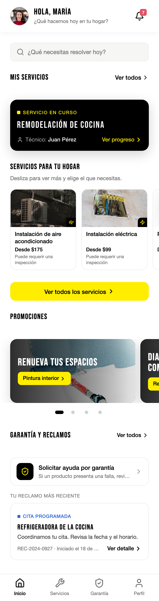

| # | Elemento | Tipo | Detalle |
|---|---|---|---|
| 1 | Avatar con la inicial | Círculo amarillo 48px | Inicial del nombre en Bebas |
| 2 | "HOLA, MARÍA" | Título | Bebas 24px, caja alta |
| 3 | "¿Qué hacemos hoy en tu hogar?" | Bajada | Helvetica 13px `--gray-60` |
| 4 | Campana con contador | Botón | `aria-label` = `"Notificaciones, 7 sin leer"`. Globo rojo con el número. Va a `/notificaciones` |
| 5 | "¿Qué necesitas resolver hoy?" | Buscador (botón) | `BuscadorServicios`. Abre `/catalogo?enfocar=1` |
| 6 | "MIS SERVICIOS" + "Ver todos" | Encabezado de sección | `Ver todos` solo con más de un servicio en curso; va a `/proyectos` |
| 7 | Card negra del servicio activo | `AvisoProximaVisita` prioridad alta | Chip "SERVICIO EN CURSO" amarillo, nombre en Bebas 24px blanco, técnico y "Ver progreso" |
| 8 | "SERVICIOS PARA TU HOGAR" + bajada | Encabezado de sección | Bajada: "Desliza para ver más y elige el que necesitas." |
| 9 | Carrusel de servicios destacados | `SeccionServicios` | Cards con foto, nombre (2 líneas), `Desde $N` y "Puede requerir una inspección" |
| 10 | "Ver todos los servicios" | Botón amarillo | Ancho completo, va a `/catalogo` |
| 11 | "PROMOCIONES" | Encabezado de sección | — |
| 12 | Carrusel de promociones | `SeccionPromociones` | Banner negro con título en Bebas y botón amarillo con el servicio |
| 13 | Puntos del carrusel | Indicador | El activo es una barra alargada; los otros, puntos |
| 14 | "GARANTÍA Y RECLAMOS" + "Ver todos" | Encabezado de sección | `Ver todos` con más de un reclamo; va a `/garantia` |
| 15 | "Solicitar ayuda por garantía" | Fila tocable completa | Sello negro con escudo; subtítulo truncado a una línea |
| 16 | "TU RECLAMO MÁS RECIENTE" | Rótulo | Bebas, caja alta, `--gray-40` |
| 17 | Card del reclamo | `TarjetaReclamoCompacta` | Chip de estado, producto en Bebas, una línea de situación, referencia + "Ver detalle" |
| 18 | Tab bar | Navegación | Inicio activo |

**Reglas de contenido y truncado**

- El nombre del servicio destacado se corta a **2 líneas** (`line-clamp-2`); las cards del carrusel tienen alto fijo para que todas midan igual.
- La fila de referencia del reclamo se trunca a una línea: en la captura se lee `REC-2024-0927 · Iniciado el 18 de …`.
- El subtítulo de "Solicitar ayuda por garantía" se trunca a una línea.
- El saludo usa solo el **primer nombre**.

**Navegación.** Campana lleva a `/notificaciones`. Buscador lleva a `/catalogo?enfocar=1`. Card de servicio lleva a `/servicios/:id`. "Ver todos" de servicios lleva a `/proyectos`. Card de catálogo lleva a `/catalogo/:id`. Promoción lleva al servicio asociado (`lib/navegacion.ts`). Fila de garantía lleva a `/garantia/producto`. Card de reclamo lleva a `/reclamos/:id`.

**Estados**

| Estado | Qué se ve |
|---|---|
| Cargando | Skeletons con la forma de cada sección |
| Error de una sección | `BloqueError` en esa sección; el resto del Home sigue |
| Sin servicios | La instancia de prioridad media muestra el vacío con "Explorar servicios" |
| Sin reclamos | La sección de garantía deja solo la fila de acceso |
| Sin notificaciones sin leer | La campana va sin globo |

**Pendientes**

- ⚠️ **Pendiente de definición.** Los servicios destacados son una lista fija en `src/app/data/catalogo.ts`, no una selección de negocio. Hay que definir quién los elige y con qué criterio.
- ⚠️ **Pendiente de definición.** El intervalo del carrusel de promociones es `INTERVALO_CARRUSEL_MS = 5000` y está marcado como provisional en `src/app/logic/promociones.ts`.

---

### 6.2 Servicios (catálogo)

| | |
|---|---|
| **Ruta** | `/catalogo` |
| **Archivo** | `src/app/pages/CatalogoServicios.tsx` |
| **Objetivo** | Encontrar un servicio, por categoría o buscando |

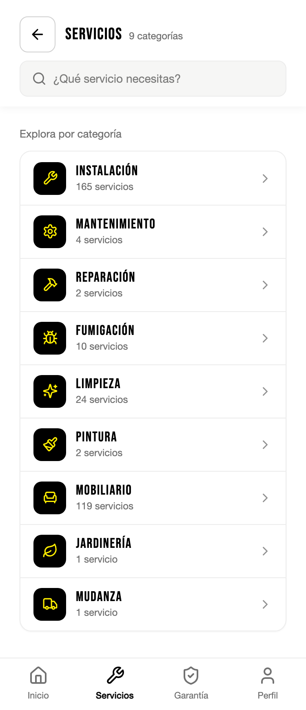

| # | Elemento | Tipo | Detalle |
|---|---|---|---|
| 1 | Botón de volver | Botón 44×44 | Radio 10, borde `--gray-20` |
| 2 | "SERVICIOS" | Título | Bebas 20px |
| 3 | "9 categorías" | Contador | Helvetica 13px `--gray-60`, junto al título |
| 4 | "¿Qué servicio necesitas?" | Input de búsqueda | 44px, fondo `--gray-3`. Con `?enfocar=1` arranca enfocado |
| 5 | "Explora por categoría" | Rótulo | Helvetica 13–14px `--gray-60` |
| 6–14 | Filas de categoría | Lista en una card | Sello negro 44px con ícono amarillo, nombre en Bebas, "N servicios", chevron |
| 15 | Tab bar | Navegación | Servicios activo |

**Reglas de contenido y truncado**

- Las filas están dentro de **una sola card** con divisores de 1px `--gray-8`, no como cards separadas.
- El contador de cada categoría se escribe en singular cuando es 1 ("1 servicio").
- Al escribir en el buscador, la lista de categorías se reemplaza por resultados en vivo.

**Navegación.** La fila de categoría abre la categoría **dentro de la misma pantalla** (estado interno). Resultado de búsqueda lleva a `/catalogo/:id`.

**Estados**: lista completa, categoría abierta, resultados de búsqueda, búsqueda sin resultados.

**Pendientes**

- ⚠️ **Pendiente de definición.** La categoría abierta **no tiene ruta propia**: no se puede compartir por link, no se entra directo desde una notificación y el botón de volver del navegador no sale de la categoría. Archivo: `src/app/pages/CatalogoServicios.tsx`.
- ⚠️ **Pendiente de definición.** Los conteos por categoría salen de los fixtures y son desparejos (165 en Instalación contra 1 en Jardinería). Falta el catálogo real.

---

### 6.3 Ficha del servicio

| | |
|---|---|
| **Ruta** | `/catalogo/:id` |
| **Archivo** | `src/app/pages/DetalleCatalogo.tsx` |
| **Objetivo** | Explicar qué incluye el servicio, cuánto cuesta y qué pasa después, antes de agendar |

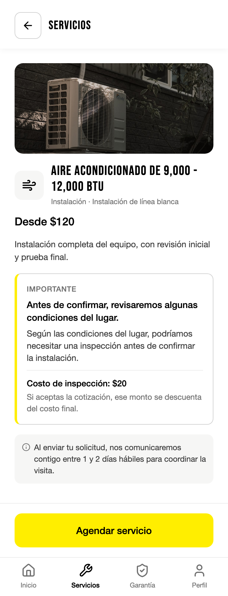

| # | Elemento | Tipo | Detalle |
|---|---|---|---|
| 1 | Volver + "SERVICIOS" | Header | Mismo header que el catálogo |
| 2 | Foto del servicio | Imagen | Radio 14, ancho completo. `ImageWithFallback` |
| 3 | Sello con el ícono de la categoría | Caja 48px | Fondo `--gray-3`, ícono 24px |
| 4 | "AIRE ACONDICIONADO DE 9,000 - 12,000 BTU" | Título | Bebas, 2 líneas cuando hace falta |
| 5 | "Instalación · Instalación de línea blanca" | Ruta de categoría | Helvetica 13px `--gray-40` |
| 6 | "Desde $120" | Precio | Helvetica 20px |
| 7 | Descripción | Párrafo | Helvetica 14px/1.5 |
| 8 | Bloque "IMPORTANTE" | Card con acento | Borde izquierdo amarillo de 4px, radio 16, borde `--gray-8` |
| 9 | "Antes de confirmar, revisaremos algunas condiciones del lugar." | Título del bloque | Helvetica 14px medium |
| 10 | Explicación de la inspección | Párrafo | `avisoEvaluacion()` en `logic/catalogo.ts` |
| 11 | "Costo de inspección: $20" + descuento | Bloque separado por hairline | La inspección **no se suma** al estimado |
| 12 | Aviso de contacto | Card `--gray-3` radio 10 | Ícono `Info` 14px + "Al enviar tu solicitud, nos comunicaremos contigo entre 1 y 2 días hábiles…" |
| 13 | "Agendar servicio" | CTA fijo al pie | Amarillo, ancho completo, sobre borde superior `--gray-8` |
| 14 | Tab bar | Navegación | Servicios activo |

**Reglas de contenido**

- El precio **siempre** se presenta como `Desde $N` (`presentarPrecio()` en `logic/catalogo.ts`), con la unidad cuando existe (`Desde $12 por m²`).
- El aviso de inspección lo decide **una sola** función, `avisoEvaluacion()`: no se escribe a mano por servicio.
- El costo de inspección va **aparte** del estimado, con la aclaración de que se descuenta si se acepta la cotización.

**Navegación.** "Agendar servicio" lleva a `/catalogo/:id/revisar-lugar` cuando el servicio necesita revisión del lugar; si no, `/catalogo/:id/configurar`.

**Estados**: con y sin inspección, precio cotizable (sin monto), servicio no encontrado (mensaje + vuelta).

**Pendientes**

- ⚠️ **Pendiente de definición.** Las fotos son de Unsplash, de demostración. Falta el set real del PIM, y con él la decisión de proporción y recorte. Archivo: `src/app/data/catalogo.ts`.

---

### 6.4 Agendar · Paso 1 · Configura el servicio

| | |
|---|---|
| **Ruta** | `/catalogo/:id/configurar` |
| **Archivo** | `src/app/pages/ConfigurarServicio.tsx` |
| **Objetivo** | Definir cuántas unidades y sumar contexto opcional (fotos y notas) |

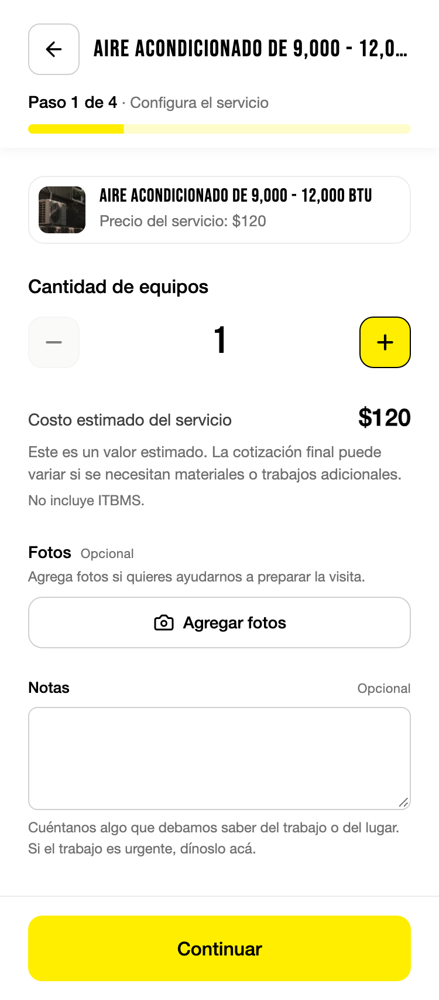

| # | Elemento | Tipo | Detalle |
|---|---|---|---|
| 1 | Volver + nombre del servicio | `EncabezadoFlujo` | Título `truncate`: "AIRE ACONDICIONADO …" |
| 2 | "Paso 1 de 4 · Configura el servicio" | Indicador de paso | 14px medium + 13px gris |
| 3 | Barra de progreso | `ui/progress` | 25% en este paso |
| 4 | Card del servicio | Resumen | Miniatura, nombre en Bebas, "Precio del servicio: $120" |
| 5 | "Cantidad de equipos" | Título de bloque | Helvetica 16px medium |
| 6 | Contador | − / número / + | El `+` es amarillo; el `−` gris y se deshabilita en 1. Número en Bebas |
| 7 | "Costo estimado del servicio" + monto | Fila de total | `DesgloseCosto`. Monto a 20px peso 700 |
| 8 | Aclaración del estimado | Párrafo | "Este es un valor estimado. La cotización final puede variar…" |
| 9 | "No incluye ITBMS." | Nota | Helvetica 12px `--gray-60` |
| 10 | "Fotos" + `Opcional` | Label con marca | `MarcaCampo` |
| 11 | "Agregar fotos" | Botón con borde | Ícono `Camera` |
| 12 | "Notas" + `Opcional` | Label con marca | `MarcaCampo` |
| 13 | Área de texto | Textarea | Redimensionable, radio 8 |
| 14 | Ayuda de las notas | Párrafo | "Cuéntanos algo que debamos saber del trabajo o del lugar. Si el trabajo es urgente, dínoslo acá." |
| 15 | "Continuar" | CTA fijo al pie | Amarillo |

**Sin tab bar** (ruta del flujo).

**Navegación.** "Continuar" lleva a `/catalogo/:id/direccion`. Volver lleva a la etapa anterior; el borrador persiste.

**Estados**: cantidad en 1 (menos deshabilitado), con adicional de desinstalación (aparece su fila en el desglose), servicio cotizable (sin monto).

**Pendientes**

- ⚠️ **Pendiente de definición.** "Agregar fotos" **no abre selector de archivos**: el prototipo no sube imágenes. Falta definir cantidad máxima, peso y formatos.
- ⚠️ **Pendiente de definición.** Las notas **no tienen límite de caracteres**: quedó sin definir por decisión expresa. Hay que fijarlo antes de producción.

---

### 6.5 Agendar · Paso 3 · Fecha preferida

| | |
|---|---|
| **Ruta** | `/catalogo/:id/fecha` |
| **Archivo** | `src/app/pages/FechaServicio.tsx` |
| **Objetivo** | Elegir día y franja preferidos, sabiendo que MiPRO confirma después |

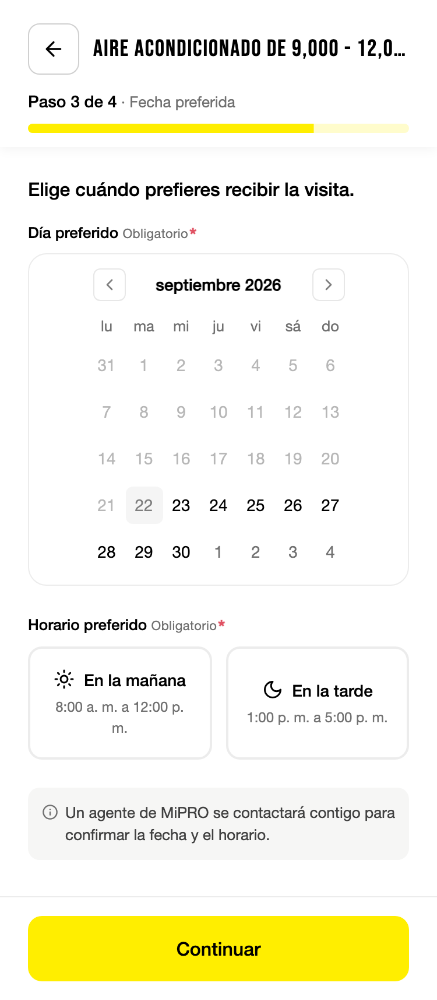

| # | Elemento | Tipo | Detalle |
|---|---|---|---|
| 1 | `EncabezadoFlujo` | Header | "Paso 3 de 4 · Fecha preferida", barra al 75% |
| 2 | "Elige cuándo prefieres recibir la visita." | Título | Helvetica 16px medium |
| 3 | "Día preferido" + `Obligatorio*` | Label con marca | `MarcaCampo` |
| 4 | Calendario | `ui/calendar` | Card radio 12, borde `--gray-8`. Mes con flechas ‹ › |
| 5 | Días anteriores a mañana | Deshabilitados | `disabled={{ before: mañana }}`: hoy no es elegible |
| 6 | "Horario preferido" + `Obligatorio*` | Label con marca | — |
| 7 | "En la mañana" / "En la tarde" | Dos tarjetas de opción | Íconos `Sun` y `Moon`; franjas "8:00 a. m. a 12:00 p. m." y "1:00 p. m. a 5:00 p. m." |
| 8 | Aviso | Card `--gray-3` | "Un agente de MiPRO se contactará contigo para confirmar la fecha y el horario." |
| 9 | "Continuar" | CTA fijo al pie | Amarillo |

**Reglas de contenido.** Las horas se escriben con el formato de Panamá: `8:00 a. m.`, con espacios finos y punto. La semana empieza en lunes y los nombres de día van en minúscula y abreviados a dos letras.

**Navegación.** "Continuar" lleva a `/catalogo/:id/resumen`.

**Estados**: sin elegir (el CTA valida al tocarlo y muestra el error), día elegido, franja elegida, ambos elegidos.

---

### 6.6 Agendar · Paso 4 · Revisa y confirma

| | |
|---|---|
| **Ruta** | `/catalogo/:id/resumen` |
| **Archivo** | `src/app/pages/ResumenServicio.tsx` |
| **Objetivo** | Revisar todo antes de confirmar, con acceso directo a corregir cada bloque |

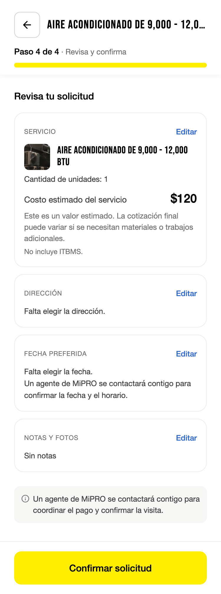

| # | Elemento | Tipo | Detalle |
|---|---|---|---|
| 1 | `EncabezadoFlujo` | Header | "Paso 4 de 4 · Revisa y confirma", barra al 100% |
| 2 | "Revisa tu solicitud" | Título | Helvetica 16px medium |
| 3 | Bloque "SERVICIO" + "Editar" | Card | Rótulo en `--gray-40` caja alta; "Editar" en `--info-blue` |
| 4 | Contenido del servicio | Miniatura + nombre + "Cantidad de unidades: N" + desglose | `DesgloseCosto` |
| 5 | Bloque "DIRECCIÓN" + "Editar" | Card | — |
| 6 | Bloque "FECHA PREFERIDA" + "Editar" | Card | Incluye el aviso de confirmación |
| 7 | Bloque "NOTAS Y FOTOS" + "Editar" | Card | "Sin notas" cuando está vacío |
| 8 | Aviso de pago | Card `--gray-3` radio 10 | "Un agente de MiPRO se contactará contigo para coordinar el pago y confirmar la visita." |
| 9 | "Confirmar solicitud" | CTA fijo al pie | 56px de alto, radio 12, texto 16px |

**Reglas de contenido**

- Cada bloque que falta se escribe en primera persona del plural y en positivo: `"Falta elegir la dirección."`, `"Falta elegir la fecha."`.
- El pago **se coordina fuera de la app**: no hay pasarela ni monto a pagar acá.

**Patrón de validación de toda la app.** El CTA **siempre está activo**. Al tocarlo se valida y, si falta algo, aparece un error con `role="alert"` debajo del contenido: `"Revisa que la dirección y la fecha estén completas antes de confirmar."`. No se usan botones deshabilitados por formulario incompleto; `disabled` se reserva para el envío en curso.

**Navegación.** "Editar" de cada bloque lleva a la etapa correspondiente. "Confirmar solicitud" lleva a `/solicitud-enviada?id=<id>` con `replace: true`, así el botón de volver no regresa al formulario.

**Estados**: completo, incompleto (con el error), enviando.

---

### 6.7 Solicitud enviada

| | |
|---|---|
| **Ruta** | `/solicitud-enviada?id=<id>` |
| **Archivo** | `src/app/pages/SolicitudEnviada.tsx` |
| **Objetivo** | Confirmar que la solicitud llegó y dejar claro qué sigue |

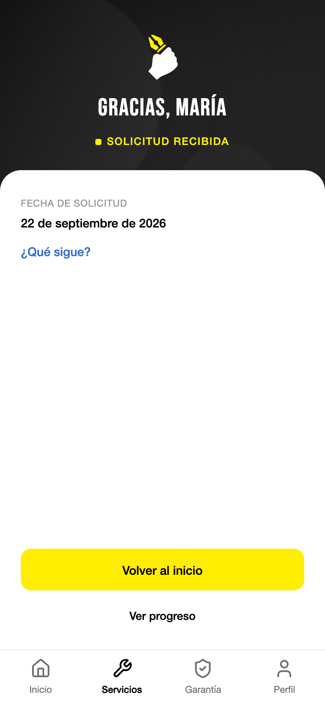

| # | Elemento | Tipo | Detalle |
|---|---|---|---|
| 1 | Bloque oscuro superior | Fondo con gradiente | Ocupa el tercio superior; la hoja blanca de abajo tiene radio arriba |
| 2 | Isotipo de MiPRO | `ManoMiPRO` | Palma blanca, rayos amarillos. **Nunca oscuro** |
| 3 | "GRACIAS, MARÍA" | Título | Bebas, blanco, caja alta |
| 4 | "SOLICITUD RECIBIDA" | Chip de estado | Amarillo con punto |
| 5 | "FECHA DE SOLICITUD" | Rótulo | `--gray-40`, caja alta |
| 6 | "22 de septiembre de 2026" | Dato | Helvetica 16px medium |
| 7 | "¿Qué sigue?" | Enlace | `--info-blue`; abre la explicación |
| 8 | "Volver al inicio" | CTA amarillo | — |
| 9 | "Ver progreso" | Acción secundaria | Va al detalle del servicio creado, o a `/proyectos` |
| 10 | Tab bar | Navegación | Servicios activo |

**Navegación.** "Volver al inicio" lleva a `/`. "Ver progreso" lleva a `/servicios/:id` con `replace: true`.

---

### 6.8 Mis servicios

| | |
|---|---|
| **Ruta** | `/proyectos` |
| **Archivo** | `src/app/pages/ProyectosList.tsx` |
| **Objetivo** | Ver todos los servicios, en curso y finalizados |

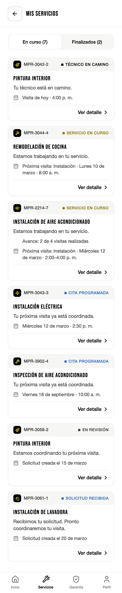

| # | Elemento | Tipo | Detalle |
|---|---|---|---|
| 1 | Volver + "MIS SERVICIOS" | Header | — |
| 2 | "En curso (7)" / "Finalizados (2)" | `ui/tabs` | Dos pestañas con el conteo. Fondo `--gray-3`, pestaña activa blanca |
| 3–9 | Cards de servicio | `TarjetaServicio` | Una por servicio |
| 10 | Tab bar | Navegación | Servicios activo |

**Anatomía de la card** (igual para todos los estados, solo cambian chip, frase y metadatos):

| Zona | Contenido |
|---|---|
| Cabecera | Sello negro con el ícono del servicio + número de reserva (`MPR-3042-2`) a la izquierda; chip de estado a la derecha |
| Cuerpo | Nombre en Bebas + **una** frase de situación |
| Metadatos | Avance ("2 de 4 visitas realizadas") cuando el plan está confirmado; fecha con ícono `CalendarDays` |
| Pie | "Ver detalle" con chevron, sobre hairline |

**Los siete estados y su frase**

| Chip | Color del chip | Frase |
|---|---|---|
| SOLICITUD RECIBIDA | `--info-blue` | "Recibimos tu solicitud. Pronto coordinaremos tu visita." |
| EN REVISIÓN | `--gray-80` | "Estamos coordinando tu próxima visita." |
| CITA PROGRAMADA | `--info-blue` | "Tu próxima visita ya está coordinada." |
| TÉCNICO EN CAMINO | `--primary-black` | "Tu técnico está en camino." |
| SERVICIO EN CURSO | `#8A7A00` | "Estamos trabajando en tu servicio." |
| SERVICIO FINALIZADO | `--success-green` | Cierre con su fecha |
| SOLICITUD CANCELADA | `--error-red` | Cierre con su fecha |

**Reglas de contenido**

- La fecha de hoy se escribe `"Visita de hoy · 4:00 p. m."`; las otras, `"Miércoles 12 de marzo · 2:00–4:00 p. m."` (rango con guion corto).
- Sin fecha coordinada se muestra `"Solicitud creada el 15 de marzo"`.
- El propósito de la visita sale de la **nomenclatura controlada** de backoffice (`TIPOS_VISITA` en `logic/servicios.ts`), nunca de texto libre del operador.

**Estados**: en curso, finalizados, vacío, cargando, error. Los escenarios de QA se fuerzan con `?servicios=error|cargando|vacio|encamino|proxima|porasignar`.

**Pendientes**

- ⚠️ **Pendiente de definición.** "Próxima visita" aparece solo cuando el modelo confirma el plan (`totalVisitasConfirmado`). Falta acordar con backoffice cuándo se considera confirmado.
- ⚠️ **Pendiente de definición.** "Técnico en camino" existe en la app y en `statusConfig`, pero el modelo actual no lo emite: se muestra solo desde un fixture.

---

### 6.9 Detalle del servicio

| | |
|---|---|
| **Ruta** | `/servicios/:id` |
| **Archivo** | `src/app/pages/DetalleServicio.tsx` |
| **Objetivo** | Ver el servicio completo con todas sus visitas y qué hacer si algo cambia |

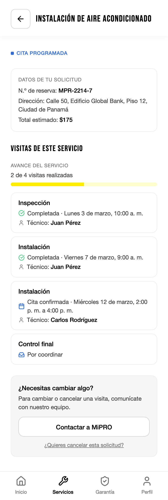

| # | Elemento | Tipo | Detalle |
|---|---|---|---|
| 1 | Volver + nombre del servicio | Header | Bebas 20px, `truncate` |
| 2 | Chip de estado | Chip | Bajo el header, alineado a la izquierda |
| 3 | "DATOS DE TU SOLICITUD" | Card de datos | Rótulo en `--gray-40` |
| 4 | "N.º de reserva: MPR-2214-7" | Dato | Etiqueta normal + valor en peso 500 |
| 5 | "Dirección: …" | Dato | Hasta 2 líneas |
| 6 | "Total estimado: $175" | Dato | — |
| 7 | "VISITAS DE ESTE SERVICIO" | Título de sección | Bebas 18px |
| 8 | "AVANCE DEL SERVICIO" + "2 de 4 visitas realizadas" | Bloque de avance | Rótulo `--gray-40` + barra amarilla |
| 9–12 | Cards de visita | `ListaCitasServicio` | Una por cita |
| 13 | "¿Necesitas cambiar algo?" | Card `--gray-3` | Con su explicación |
| 14 | "Contactar a MiPRO" | Botón con borde | Abre el drawer `ContactarMiPRO` |
| 15 | "¿Quieres cancelar esta solicitud?" | Enlace subrayado | Abre el mismo drawer con el mensaje de cancelación |
| 16 | Tab bar | Navegación | Servicios activo |

**Card de visita.** Título = propósito (`Inspección`, `Instalación`, `Control final`). Debajo, **estado y después fecha**: `"Completada · Lunes 3 de marzo, 10:00 a. m."`, con el ícono y el color del estado. Pie con `"Técnico: Juan Pérez"` cuando está asignado. Sin fecha: `"Por coordinar"`.

**Vocabulario de estados de cita.** Uno solo, en `src/app/logic/estadosCita.ts`: `Por coordinar`, `Cita confirmada`, `En curso`, `Completada`, `Cancelada`. El recorrido son los primeros cuatro (sin `Cancelada`). `normalizarEstadoCita` mapea los nombres viejos del backoffice.

**Estados**: con y sin avance confirmado, servicio finalizado (aparece `CalificacionServicio`), cancelado, no encontrado ("No encontramos este servicio." + "Volver a Mis servicios").

**Pendientes**

- ⚠️ **Inconsistencia detectada.** `"En pausa"` existe en `statusConfig.ts` pero **no está mapeado** en `EQUIVALENCIAS` de `estadosCita.ts`, porque no está definido a qué estado del cliente corresponde. Si el backoffice lo emite, la cita cae en el genérico. Archivos: `src/app/logic/estadosCita.ts`, `src/app/utils/statusConfig.ts`.
- ⚠️ **Pendiente de definición.** Cancelar no cancela la solicitud: abre el canal de contacto. Falta definir si la cancelación va a ser autogestionada.

---

### 6.10 Garantía y reclamos (hub)

| | |
|---|---|
| **Ruta** | `/garantia` |
| **Archivo** | `src/app/pages/GarantiaHub.tsx` |
| **Objetivo** | Iniciar una solicitud de garantía y seguir las que ya existen |

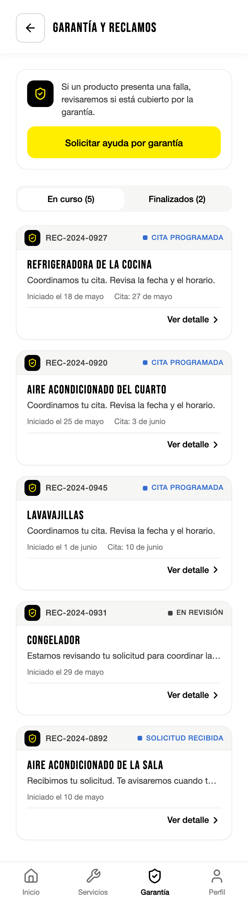

| # | Elemento | Tipo | Detalle |
|---|---|---|---|
| 1 | Volver + "GARANTÍA Y RECLAMOS" | Header | — |
| 2 | Card de inicio | Card blanca radio 14 | Sello negro con escudo + explicación de dos líneas |
| 3 | "Solicitar ayuda por garantía" | CTA amarillo | Dentro de la card, ancho completo |
| 4 | "En curso (5)" / "Finalizados (2)" | `ui/tabs` | Con conteo |
| 5–9 | Cards de reclamo | `TarjetaReclamoHub` | Una por caso |
| 10 | Tab bar | Navegación | Garantía activo |

**Anatomía de la card de reclamo**

| Zona | Contenido |
|---|---|
| Cabecera | Fondo `--gray-3`: sello negro con escudo + número de caso (`REC-2024-0927`); chip de estado a la derecha |
| Cuerpo | Producto en Bebas (**1 línea, truncado**) + una frase de situación |
| Metadatos | `"Iniciado el 18 de mayo"` y, cuando existe, `"Cita: 27 de mayo"` |
| Pie | "Ver detalle" con chevron, sobre hairline. Botón amarillo **solo** cuando el usuario debe actuar |

**Los cinco estados de caso** (`ESTADOS_CASO_RECLAMO` en `logic/reclamos.ts`): Solicitud recibida, En revisión, Cita programada, Necesitamos información, Finalizado / No cubierto.

**Reglas de contenido y truncado**

- El nombre del producto se corta a **una línea**: en la captura, `REFRIGERADORA DE LA CO…`.
- La frase de situación se corta a una línea: `Estamos revisando tu solicitud para coordinar la…`.
- Las filas tienen **alto fijo**: todas las cards del listado miden lo mismo.

⚠️ **Inconsistencia detectada.** `TarjetaReclamo` (en `/reclamos`) muestra el producto **sin truncar** y `TarjetaReclamoHub` lo trunca a una línea. El mismo dato se corta distinto según la pantalla. Archivos: `components/reclamos/TarjetaReclamo.tsx`, `components/reclamos/TarjetaReclamoHub.tsx`.

**Navegación.** CTA lleva a `/garantia/producto`. Card lleva a `/reclamos/:id`.

---

### 6.11 Garantía · Paso 1 · Datos de la compra y del producto

| | |
|---|---|
| **Ruta** | `/garantia/producto` |
| **Archivo** | `src/app/pages/GarantiaProducto.tsx` |
| **Objetivo** | Reunir lo que define la cobertura: comprobante y producto |

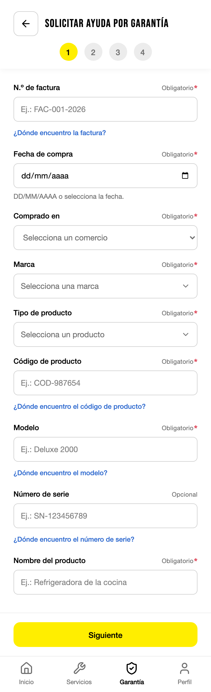

| # | Elemento | Marca | Control | Ayuda |
|---|---|---|---|---|
| 1 | "N.º de factura" | `Obligatorio*` | Input, `Ej.: FAC-001-2026` | "¿Dónde encuentro la factura?" |
| 2 | "Fecha de compra" | `Obligatorio*` | Input de fecha nativo (`dd/mm/aaaa` + ícono) | "DD/MM/AAAA o selecciona la fecha." |
| 3 | "Comprado en" | `Obligatorio*` | `SelectorBuscable`, "Selecciona un comercio" | — |
| 4 | "Marca" | `Obligatorio*` | `SelectorBuscable`, "Selecciona una marca" | — |
| 5 | "Tipo de producto" | `Obligatorio*` | `SelectorBuscable`, "Selecciona un producto" | — |
| 6 | "Código de producto" | `Obligatorio*` | Input, `Ej.: COD-987654` | "¿Dónde encuentro el código de producto?" |
| 7 | "Modelo" | `Obligatorio*` | Input, `Ej.: Deluxe 2000` | "¿Dónde encuentro el modelo?" |
| 8 | "Número de serie" | **`Opcional`** | Input, `Ej.: SN-123456789` | "¿Dónde encuentro el número de serie?" |
| 9 | "Nombre del producto" | `Obligatorio*` | Input, `Ej.: Refrigeradora de la cocina` | — |
| 10 | "Siguiente" | — | CTA amarillo fijo al pie | — |

Arriba, `ProgresoPasos` con el 1 activo. Header con el título `SOLICITAR AYUDA POR …` truncado.

**Reglas de contenido**

- **El orden de los campos es este**: "Marca" va entre "Comprado en" y "Tipo de producto".
- **"Número de serie" es el único opcional** del formulario: es el dato más difícil de encontrar, porque la etiqueta es chica y a veces está detrás del equipo. El resto define la cobertura y la app no tiene cómo pedirlo después del envío.
- Si el producto se elige de los registrados, **no se vuelve a pedir ningún dato**.
- Los enlaces "¿Dónde encuentro…?" abren un `AyudaSheet` con el `DiagramaRecibo`: el mismo comprobante simulado, resaltando factura o código según el caso. La ayuda **nunca dice que falta contenido**.
- Los mensajes de error están en lenguaje claro, nunca "campo inválido": `"Elige un producto o ingresa sus datos para continuar."`

**Navegación.** "Siguiente" lleva a `/garantia/problema`.

**Pendientes**

- ⚠️ **Pendiente de definición.** Las listas de comercios, marcas y tipos de producto son locales (`src/app/data/`). Falta la fuente real.

---

### 6.12 Garantía · Paso 2 · Problema reportado

| | |
|---|---|
| **Ruta** | `/garantia/problema` |
| **Archivo** | `src/app/pages/GarantiaProblema.tsx` |
| **Objetivo** | Clasificar la falla con una taxonomía cerrada |

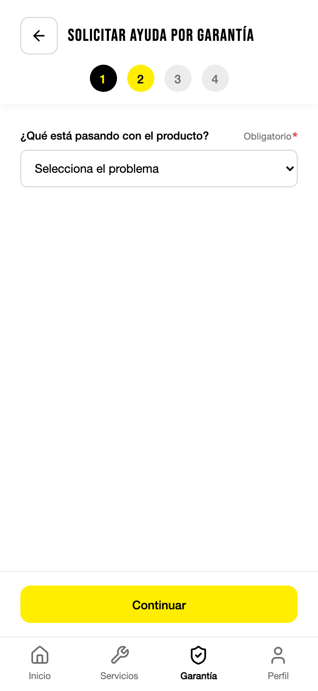

| # | Elemento | Tipo | Detalle |
|---|---|---|---|
| 1 | `ProgresoPasos` | Indicador | 1 completado (negro), 2 activo (amarillo), 3 y 4 pendientes |
| 2 | "¿Qué está pasando con el producto?" | Label + `Obligatorio*` | — |
| 3 | "Selecciona el problema" | Selector | 7 categorías |
| 4 | "Continuar" | CTA amarillo fijo al pie | — |

**Las siete categorías** (`CATEGORIAS_PROBLEMA` en `logic/solicitudGarantia.ts`): No enciende, No funciona correctamente, Hace un ruido extraño, Pierde agua, Muestra un error, Está dañado, Otro problema.

**Aviso de seguridad.** Una categoría puede traer un aviso preventivo aprobado, que aparece al elegirla. Hoy solo lo tiene "Pierde agua": *"Por seguridad, desconecta el producto y no intentes repararlo por tu cuenta."*

**Estados**: sin elegir (como en la captura), elegida, elegida con aviso de seguridad, "Otro problema" (habilita la descripción libre).

**Pendientes**

- ⚠️ **Pendiente de definición.** La taxonomía es una **propuesta, no la lista productiva**. Está marcada así en el código y hay que validarla con operaciones.

---

### 6.13 Garantía · Paso 3 · Contacto y dirección

| | |
|---|---|
| **Ruta** | `/garantia/revisar` |
| **Archivo** | `src/app/pages/GarantiaRevisar.tsx` |
| **Objetivo** | Confirmar a quién se contacta y dónde está el producto |

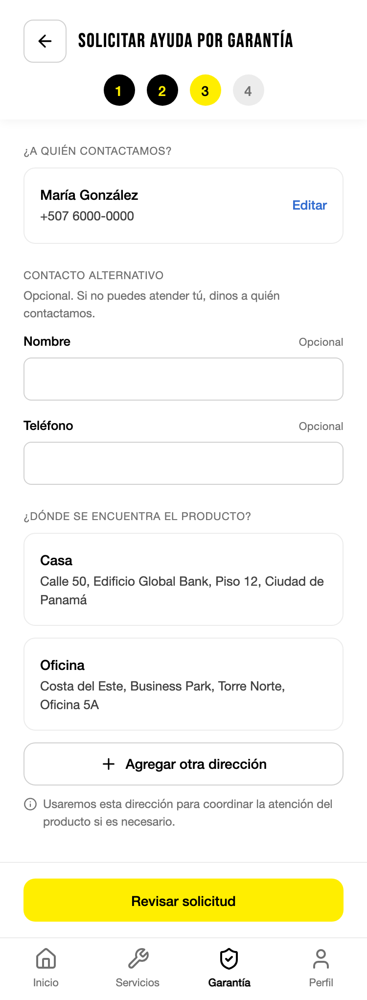

| # | Elemento | Tipo | Detalle |
|---|---|---|---|
| 1 | `ProgresoPasos` | Indicador | 3 activo |
| 2 | "¿A QUIÉN CONTACTAMOS?" | Rótulo de sección | `--gray-40`, caja alta |
| 3 | Card del titular | Card | "María González" + "+507 6000-0000" + "Editar" en `--info-blue` |
| 4 | "CONTACTO ALTERNATIVO" | Rótulo de sección | Con su explicación: "Opcional. Si no puedes atender tú, dinos a quién contactamos." |
| 5 | "Nombre" | Label + `Opcional` | Input |
| 6 | "Teléfono" | Label + `Opcional` | Input |
| 7 | "¿DÓNDE SE ENCUENTRA EL PRODUCTO?" | Rótulo de sección | — |
| 8 | Direcciones guardadas | Cards seleccionables | Alias en peso 500 + dirección completa hasta 2 líneas |
| 9 | "Agregar otra dirección" | Botón con borde | Ícono `+` |
| 10 | Aviso | Card `--gray-3` | "Usaremos esta dirección para coordinar la atención del producto si es necesario." |
| 11 | "Revisar solicitud" | CTA amarillo fijo al pie | — |

**Reglas de contenido.** El contacto alternativo es **el único bloque opcional** del flujo: marca `Opcional` en los dos campos.

**Navegación.** "Editar" abre los datos del titular. "Agregar otra dirección" lleva a `/garantia/direccion/nueva`. "Revisar solicitud" lleva a `/garantia/confirmar`.

---

### 6.14 Garantía · Paso 4 · Revisar y enviar

| | |
|---|---|
| **Ruta** | `/garantia/confirmar` |
| **Archivo** | `src/app/pages/GarantiaConfirmar.tsx` |
| **Objetivo** | Revisión final, con acceso a corregir cada bloque |

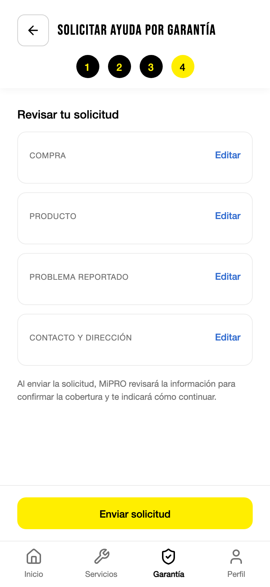

| # | Elemento | Tipo | Detalle |
|---|---|---|---|
| 1 | `ProgresoPasos` | Indicador | 1-2-3 completados, 4 activo |
| 2 | "Revisar tu solicitud" | Título | Helvetica 16px medium |
| 3 | Bloque "COMPRA" + "Editar" | Card | Factura y fecha |
| 4 | Bloque "PRODUCTO" + "Editar" | Card | Marca, tipo, modelo, código, serie |
| 5 | Bloque "PROBLEMA REPORTADO" + "Editar" | Card | Categoría y descripción |
| 6 | Bloque "CONTACTO Y DIRECCIÓN" + "Editar" | Card | Titular, alternativo y dirección |
| 7 | Nota de cierre | Párrafo | "Al enviar la solicitud, MiPRO revisará la información para confirmar la cobertura y te indicará cómo continuar." |
| 8 | "Enviar solicitud" | CTA amarillo fijo al pie | `disabled` mientras envía |

> En la captura los cuatro bloques salen **sin datos** porque se entró por URL directa, sin borrador. Con el flujo recorrido, cada bloque muestra sus valores.

**Navegación.** "Enviar solicitud" lleva a `/garantia/enviada`. Desde ahí, al caso creado (`/reclamos/:id`) o al listado.

**Estados**: completo, enviando (CTA deshabilitado), error de envío.

---

### 6.15 Agregar dirección

| | |
|---|---|
| **Rutas** | `/garantia/direccion/nueva` y `/catalogo/:id/direccion/nueva` |
| **Archivos** | `pages/GarantiaAgregarDireccion.tsx`, `pages/AgregarDireccion.tsx`, `components/agendar/FormularioDireccion.tsx` |
| **Objetivo** | Dar de alta una dirección completa, una sola vez y de una sola forma |

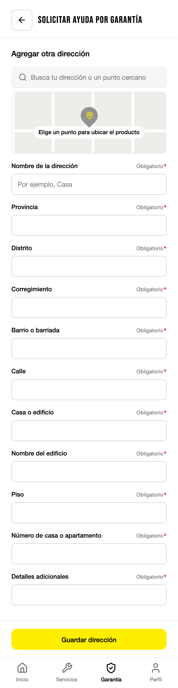

| # | Elemento | Marca | Detalle |
|---|---|---|---|
| 1 | Título del bloque | — | "Agregar otra dirección" (garantía) o "Agregar dirección" (agendamiento) |
| 2 | "Busca tu dirección o un punto cercano" | — | Barra de búsqueda, 44px, fondo `--gray-3` |
| 3 | Mapa | — | Recuadro de 130px radio 12 con un pin y el mensaje del contexto ("Elige un punto para ubicar el producto" / "…el servicio") |
| 4 | "Nombre de la dirección" | `Obligatorio*` | Único campo con placeholder: "Por ejemplo, Casa" |
| 5 | "Provincia" | `Obligatorio*` | Input de texto |
| 6 | "Distrito" | `Obligatorio*` | Input de texto |
| 7 | "Corregimiento" | `Obligatorio*` | Input de texto |
| 8 | "Barrio o barriada" | `Obligatorio*` | Input de texto |
| 9 | "Calle" | `Obligatorio*` | Input de texto |
| 10 | "Casa o edificio" | `Obligatorio*` | Input de texto |
| 11 | "Nombre del edificio" | `Obligatorio*` | Input de texto |
| 12 | "Piso" | `Obligatorio*` | Input de texto |
| 13 | "Número de casa o apartamento" | `Obligatorio*` | Input de texto |
| 14 | "Detalles adicionales" | `Obligatorio*` | Input de texto |
| 15 | "Guardar dirección" | — | CTA amarillo fijo al pie, 44px |

**Reglas de contenido**

- **Los once campos son obligatorios.** Con un campo faltante, la dirección puede no alcanzar para llegar, y la app no tiene cómo pedirlo después.
- Elegir un lugar en el mapa **autocompleta** los campos que ese lugar conoce.
- La validación es `validarDireccionNueva`: muestra el **primer** error faltante, con `role="alert"`.
- Es **un solo formulario** para los dos flujos. Antes había dos (once campos en agendamiento, cuatro en garantía).

**Navegación.** Al guardar, vuelve al paso que lo abrió con la nueva dirección ya elegida (`state: { direccionId }`, `replace: true`). Volver sin guardar **no toca** el borrador.

**Pendientes**

- ⚠️ **Inconsistencia detectada.** Provincia, distrito y corregimiento son **campos de texto libre**, aunque la app ya tiene el componente `SelectorBuscable` y datos geográficos en `data/lugaresSimulados.ts`. Escritos a mano no se pueden validar ni usar para asignar cobertura. Archivo: `components/agendar/FormularioDireccion.tsx`.
- ⚠️ **Pendiente de definición.** "Detalles adicionales" es obligatorio y no tiene ayuda que explique qué se espera ahí.
- ⚠️ **Pendiente de definición.** El mapa es un dibujo. Falta el proveedor real.

---

### 6.16 Detalle del reclamo

| | |
|---|---|
| **Ruta** | `/reclamos/:id` |
| **Archivo** | `src/app/pages/DetalleReclamo.tsx` |
| **Objetivo** | Saber en qué está el caso y qué sigue |

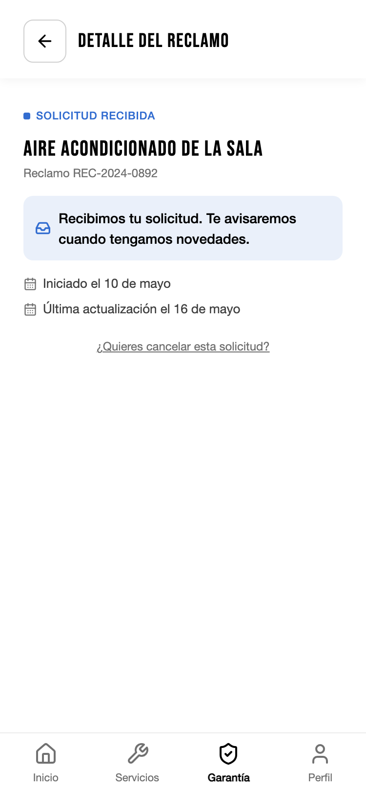

| # | Elemento | Tipo | Detalle |
|---|---|---|---|
| 1 | Volver + "DETALLE DEL RECLAMO" | Header | — |
| 2 | Chip de estado | Chip | "SOLICITUD RECIBIDA" en `--info-blue` |
| 3 | Nombre del producto | Título | Bebas, caja alta, **sin truncar** |
| 4 | "Reclamo REC-2024-0892" | Referencia | Helvetica 13px `--gray-60` |
| 5 | Card de situación | Card tonal | Fondo tenue del color del estado + ícono + la frase en peso 500 |
| 6 | "Iniciado el 10 de mayo" | Metadato | Con ícono `CalendarDays` 14px |
| 7 | "Última actualización el 16 de mayo" | Metadato | Ídem |
| 8 | "¿Quieres cancelar esta solicitud?" | Enlace subrayado | Abre `ContactarMiPRO` |
| 9 | Tab bar | Navegación | Garantía activo |

**Con cita coordinada** se suma `HistorialCitas`: una card por cita con el tipo como título, los cambios de estado con su fecha (punto + conector vertical) y el pie con técnico y horario. El historial usa el del backoffice cuando existe; si no, lo deriva de los estados alcanzados (`historialCita()` en `logic/reclamos.ts`).

**Modalidades de atención** (`ModalidadAtencion`): `taller-visita`, `cliente-lleva`, `deja-en-tienda`. Cambian el texto de la cita, no la estructura.

**Estados**: los cinco de caso; con y sin historial; el caso que requiere acción muestra el CTA amarillo.

**Pendientes**

- ⚠️ **Pendiente de definición.** El catálogo de estados de caso es el de la app, no el del backoffice. Hay que cerrarlo y confirmar quién lo emite.

---

### 6.17 Notificaciones

| | |
|---|---|
| **Ruta** | `/notificaciones` |
| **Archivo** | `src/app/pages/Notificaciones.tsx` |
| **Objetivo** | Repasar las novedades en orden y saber qué queda sin leer |

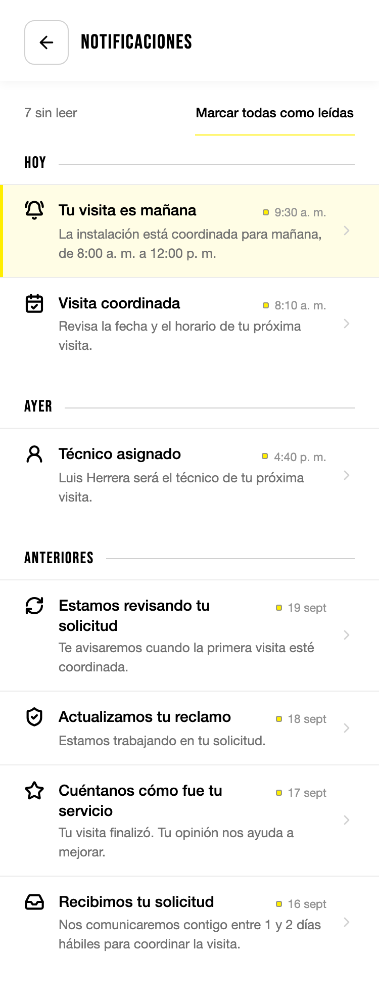

| # | Elemento | Tipo | Detalle |
|---|---|---|---|
| 1 | Volver + "NOTIFICACIONES" | Header | — |
| 2 | "7 sin leer" | Contador | Helvetica 13px `--gray-60` |
| 3 | "Marcar todas como leídas" | Acción de texto | Negro peso 500 con **subrayado amarillo** de 2px. `minHeight: 44px` |
| 4 | "HOY" | Encabezado de fecha | Bebas 16px caja alta + hairline `--gray-20` hasta el borde |
| 5 | Fila prioritaria | Fila | Superficie `rgba(255,238,0,0.10)` + barra `inset 3px 0 0` amarilla |
| 6 | Filas sin leer | Fila | Ícono negro, título peso 500, punto amarillo de 6px junto a la hora |
| 7 | "AYER" / "ANTERIORES" | Encabezados de fecha | Ídem |
| 8 | Filas leídas | Fila | Ícono `--gray-40`, título `--gray-80` peso 400, sin punto |
| 9 | Tab bar | **No hay** | `/notificaciones` está en `RUTAS_SIN_TABBAR` |

**Anatomía de la fila.** Grid de `22px 1fr 16px` con gap 12 y padding `14px 24px`; filas separadas por `1px solid var(--gray-8)`. **No son cards**: es un registro continuo. Columna 1 el ícono del tipo (20px, trazo 2.5), columna 2 título + mensaje, columna 3 el chevron.

**Los siete tipos y su ícono**

| Tipo | Ícono (lucide) |
|---|---|
| Solicitud recibida | `Inbox` |
| Técnico asignado | `UserRound` |
| Visita coordinada | `CalendarCheck` |
| Solicitud en revisión | `RefreshCw` |
| Recordatorio de visita | `BellRing` |
| Novedad de garantía | `ShieldCheck` |
| Pedido de calificación | `Star` |

**Reglas de contenido y truncado**

- Título y mensaje se cortan a **2 líneas** cada uno (`line-clamp-2`).
- La hora del día se muestra en las de hoy y ayer (`9:30 a. m.`); en las anteriores, la fecha corta (`19 sept`).
- Los grupos de fecha van separados por 26px.

**Jerarquía de la fila.** Lo no leído se marca con el ícono negro, el título en peso 500 y el punto amarillo. La barra amarilla y la superficie tenue quedan reservadas para la fila prioritaria.

**Estados**: con novedades, todo leído, vacío (estado tipográfico, sin ilustración), cargando.

**Pendientes**

- ⚠️ **Pendiente de definición.** Las notificaciones son locales: no hay push ni persistencia. "Marcar todas como leídas" se pierde al recargar.

---

### 6.18 Mi perfil

| | |
|---|---|
| **Ruta** | `/perfil` |
| **Archivo** | `src/app/pages/Perfil.tsx` |
| **Objetivo** | Datos de la cuenta y accesos a configuración y soporte |

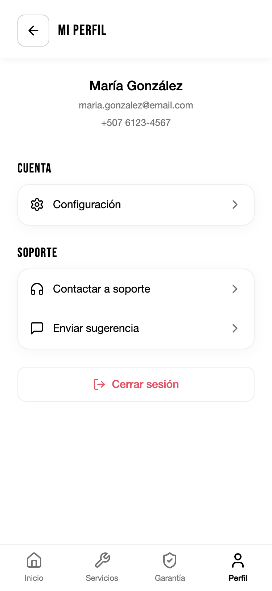

| # | Elemento | Tipo | Detalle |
|---|---|---|---|
| 1 | Volver + "MI PERFIL" | Header | — |
| 2 | "María González" | Nombre | Helvetica 20px peso 500, centrado |
| 3 | "maria.gonzalez@email.com" | Dato | `--gray-60`, centrado |
| 4 | "+507 6123-4567" | Dato | `--gray-60`, centrado |
| 5 | "CUENTA" | Rótulo de grupo | Bebas caja alta |
| 6 | "Configuración" | Fila con ícono `Settings` | Card blanca radio 14, chevron |
| 7 | "SOPORTE" | Rótulo de grupo | — |
| 8 | "Contactar a soporte" | Fila con ícono `Headphones` | — |
| 9 | "Enviar sugerencia" | Fila con ícono `MessageSquare` | — |
| 10 | "Cerrar sesión" | Botón con borde | Texto e ícono `LogOut` en `--error-red`, centrado |
| 11 | Tab bar | Navegación | Perfil activo |

**Navegación.** `/configuracion`, `/soporte`, `/sugerencias`. "Cerrar sesión" pide confirmación y va a `/welcome`.

**Pendientes**

- ⚠️ **Inconsistencia detectada.** "Cerrar sesión" usa `--error-red` (#E05263), no `--destructive` (#E2034D), que es el token de acción destructiva y **no se usa en ninguna parte**. Archivos: `src/app/pages/Perfil.tsx`, `src/styles/theme.css`.
- ⚠️ **Pendiente de definición.** Desde Perfil **no se llega a "Mis productos"**. Ver 6.21.

---

### 6.19 Configuración

| | |
|---|---|
| **Ruta** | `/configuracion` |
| **Archivo** | `src/app/pages/Configuracion.tsx` |
| **Objetivo** | Editar los datos de la cuenta |

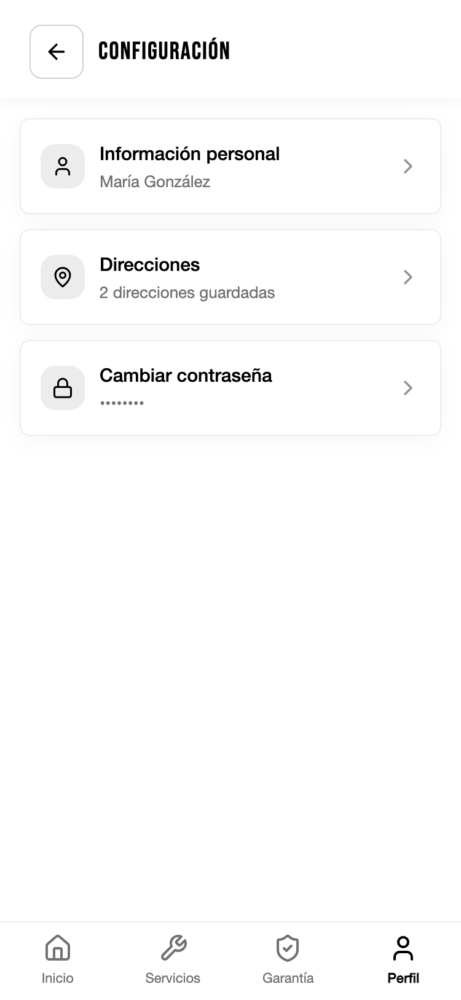

| # | Elemento | Tipo | Detalle |
|---|---|---|---|
| 1 | Volver + "CONFIGURACIÓN" | Header | — |
| 2 | "Información personal" | Fila con sello `--gray-3` | Subtítulo con el valor actual: "María González" |
| 3 | "Direcciones" | Fila | Subtítulo: "2 direcciones guardadas" |
| 4 | "Cambiar contraseña" | Fila | Subtítulo con puntos, sin revelar nada |
| 5 | Tab bar | Navegación | Perfil activo |

Cada fila es una **card independiente** (radio 14, borde `--gray-8`), a diferencia del catálogo, donde las filas viven dentro de una sola card.

**Pendientes**

- ⚠️ **Pendiente de definición.** No hay preferencias de notificación, ni idioma, ni datos de facturación. Falta definir si van en este nivel.

---

### 6.20 Enviar sugerencia

| | |
|---|---|
| **Ruta** | `/sugerencias` |
| **Archivo** | `src/app/pages/Sugerencias.tsx` |
| **Objetivo** | Recoger una calificación general y un comentario |

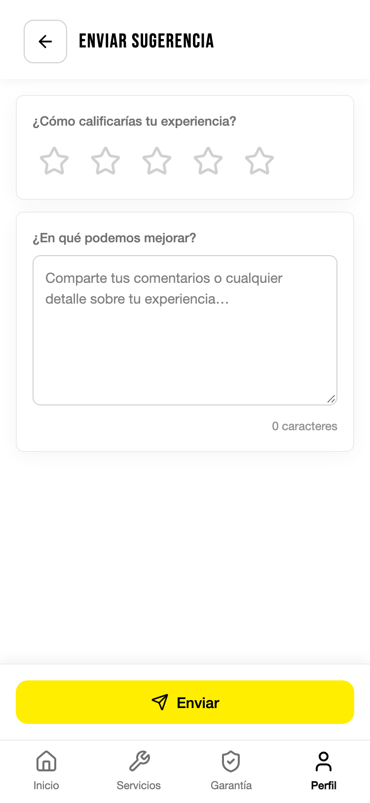

| # | Elemento | Tipo | Detalle |
|---|---|---|---|
| 1 | Volver + "ENVIAR SUGERENCIA" | Header | — |
| 2 | "¿Cómo calificarías tu experiencia?" | Pregunta en card | Helvetica 14px `--gray-80` |
| 3 | Cinco estrellas | Radiogroup | `aria-checked`. Vacías en `--gray-20`; elegidas en `--primary-yellow` (contorno y relleno) |
| 4 | "¿En qué podemos mejorar?" | Pregunta en card | — |
| 5 | Área de texto | Textarea | Placeholder "Comparte tus comentarios o cualquier detalle sobre tu experiencia…" |
| 6 | "0 caracteres" | Contador | Alineado a la derecha, `--gray-60` |
| 7 | "Enviar" | CTA amarillo fijo al pie | Con ícono `Send` |

**Reglas de contenido.** Las dos preguntas son **obligatorias**: la calificación (`"Por favor califica tu experiencia."`) y el comentario con al menos 10 caracteres (`"Escribe al menos 10 caracteres."`).

**Pendientes**

- ⚠️ **Inconsistencia detectada.** Los dos campos son obligatorios pero **no llevan la marca `Obligatorio*`**, que sí se aplica en los flujos de servicio, garantía y producto. Lo mismo pasa en las cuatro pantallas de acceso (`Welcome`, `Login`, `Signup`, `ForgotPassword`). Archivos: `src/app/pages/Sugerencias.tsx`, `src/app/pages/Login.tsx`, `src/app/pages/Signup.tsx`, `src/app/pages/ForgotPassword.tsx`.
- ⚠️ **Pendiente de definición.** El contador no tiene techo: el **límite de caracteres sigue sin definir**, por decisión expresa.
- ⚠️ **Pendiente de definición.** El envío no se guarda: no hay endpoint.

---

### 6.21 Mis productos

| | |
|---|---|
| **Ruta** | `/productos` (más `/productos/agregar` y `/productos/:id`) |
| **Archivo** | `src/app/pages/Productos.tsx` |
| **Objetivo** | Tener los productos registrados a mano para pedir garantía sin volver a cargar sus datos |

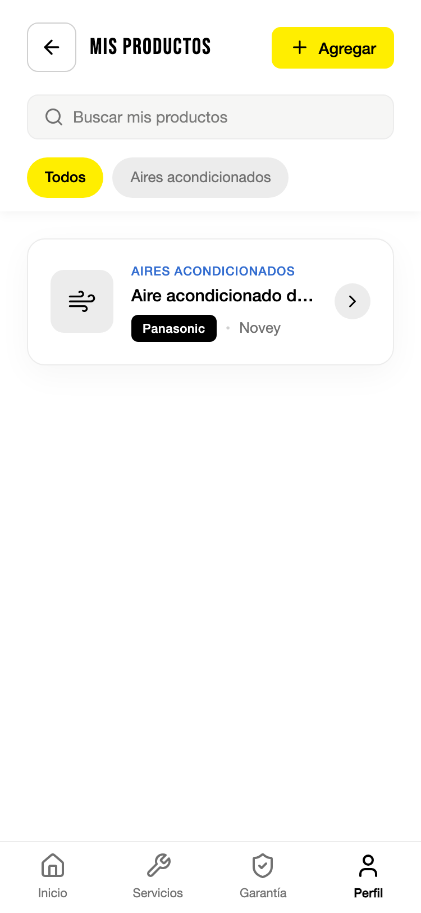

| # | Elemento | Tipo | Detalle |
|---|---|---|---|
| 1 | Volver + "MIS PRODU…" | Header | El título **se trunca** al convivir con el botón "Agregar" |
| 2 | "+ Agregar" | Botón amarillo en el header | Va a `/productos/agregar` |
| 3 | "Buscar mis productos" | Input de búsqueda | 44px, fondo `--gray-3` |
| 4 | "Todos" / "Aires acondicionados" | Chips de filtro | Píldoras; la activa amarilla, las otras `--gray-8` |
| 5 | Card de producto | Card radio 14 | Miniatura 72px, categoría en `--info-blue` caja alta, nombre truncado, chip negro con la marca + comercio, chevron en círculo |
| 6 | Tab bar | Navegación | Perfil activo |

**Pendientes**

- ⚠️ **Inconsistencia detectada.** `/productos` **no tiene ningún acceso en la interfaz**: ni Perfil ni el Home ni Garantía llevan ahí. Solo se llega escribiendo la URL. Las tres rutas de productos están implementadas y quedan inalcanzables. Archivos: `src/app/pages/Perfil.tsx`, `src/app/routes.tsx`.
- ⚠️ **Inconsistencia detectada.** Esta pantalla usa un lenguaje visual propio que no aparece en el resto de la app: **chips con forma de píldora** y **categoría en azul** (el azul está reservado para enlaces y seguimiento). Archivo: `src/app/pages/Productos.tsx`.
- ⚠️ **Pendiente de definición.** El título del header se trunca a "MIS PRODU…" por el botón "Agregar". Hay que decidir si el título se acorta o la acción se mueve.

---

## 7. Reglas funcionales visibles en la interfaz

Las reglas que se ven en pantalla. Cada una está implementada en un solo lugar del código.

### 7.1 Precio

| Regla | Dónde |
|---|---|
| El precio **siempre** se presenta como `Desde $N`, nunca como monto cerrado | `presentarPrecio()` en `src/app/logic/catalogo.ts` |
| Con unidad, se suma al final: `Desde $12 por m²` | ídem |
| Sin precio cargado se usa `PRECIO_BASE_REFERENCIAL_USD` | ídem |
| El estimado es `precio × cantidad` más los adicionales con precio real (por ejemplo la desinstalación) | `totalEstimado()`, `totalConAdicionales()` en `logic/solicitudServicio.ts` |
| La **visita de evaluación no se suma** al estimado: se muestra aparte, con la aclaración de que se descuenta de la cotización si se acepta | `components/servicios/DesgloseCosto.tsx` |
| Siempre se aclara `"No incluye ITBMS."` | `DesgloseCosto` |
| El pago se coordina **fuera de la app**: no hay pasarela | `pages/ResumenServicio.tsx` |

### 7.2 Inspección y evaluación

Una sola función decide si el servicio avisa que puede necesitar inspección: **`avisoEvaluacion()`** en `src/app/logic/catalogo.ts`. Considera tres flags del servicio: `requiereInspeccion`, `inspeccionObligatoria` y `precioCotizable`. El texto no se escribe a mano por servicio.

El costo de inspección es `PRECIO_INSPECCION_USD` (`logic/solicitudServicio.ts`) y siempre va acompañado de la regla del descuento.

### 7.3 Estados de cita

**Un solo vocabulario**, en `src/app/logic/estadosCita.ts`:

| Estado | En el recorrido | Notas |
|---|---|---|
| Por coordinar | sí | Sin fecha ni técnico |
| Cita confirmada | sí | Con fecha; el técnico puede faltar |
| En curso | sí | — |
| Completada | sí | Cierra el recorrido |
| Cancelada | **no** | Sale del recorrido |

- `normalizarEstadoCita()` traduce los nombres viejos del backoffice con el mapa `EQUIVALENCIAS`.
- `debeMostrarFecha()` y `debeMostrarTecnico()` deciden qué metadato aparece: **no se muestra un dato vacío con un rótulo**.
- `estadosAlcanzados()` arma el recorrido; `claveVisualCita()` da la clave para `statusConfig`.
- El orden de lectura es **estado y después fecha**: `"Cita confirmada · 12 de marzo"`.

⚠️ **Pendiente de definición.** `"En pausa"` no está en `EQUIVALENCIAS`: falta definir qué significa para el cliente.

### 7.4 Estados de caso de garantía

`ESTADOS_CASO_RECLAMO` en `src/app/logic/reclamos.ts`: Solicitud recibida, En revisión, Cita programada, Necesitamos información, Finalizado / No cubierto.

- El estado del caso **nunca se escribe a mano** en los fixtures: lo deriva `estadoGeneralReclamo()` de las citas, la cancelación o la resolución.
- `reclamoRequiereAccion()` decide si aparece el botón amarillo: la acción destacada solo existe cuando el usuario tiene algo que hacer.
- `citaRelevante()` elige la cita más próxima entre las coordinadas.
- `historialCita()` usa el historial del backoffice cuando existe; si no, lo deriva de los estados alcanzados.

### 7.5 Campos obligatorios

| Regla | Detalle |
|---|---|
| Marca única | `Obligatorio*` con el asterisco pegado, en `--error-red`; los opcionales, `Opcional` sin asterisco |
| Dirección | **Los once campos son obligatorios** |
| Garantía paso 1 | Todo obligatorio **menos "Número de serie"** |
| Garantía paso 3 | El contacto alternativo es el único bloque opcional |
| Configurar servicio | Fotos y notas son opcionales |
| Producto ya registrado | No se vuelve a pedir ningún dato |

**Validación al enviar, no botón deshabilitado.** El CTA está siempre activo; al tocarlo se valida y aparece el primer error faltante con `role="alert"`, en lenguaje claro (`"Elige un producto o ingresa sus datos para continuar."`), nunca "campo inválido". `disabled` se reserva para el envío en curso.

### 7.6 Borradores y persistencia

| Qué | Dónde | Vida |
|---|---|---|
| Borrador de solicitud de servicio | `logic/solicitudServicio.ts` | `sessionStorage` |
| Borrador de solicitud de garantía | `logic/solicitudGarantia.ts` | `sessionStorage` |
| Direcciones agregadas en la sesión | `data/direcciones.ts` | `sessionStorage` |
| Reclamos creados en la sesión | `data/reclamos.ts`, clave `mipro-reclamos-sesion` | `sessionStorage` |
| Calificaciones enviadas | `data/calificaciones.ts` | `sessionStorage` |

Volver atrás **no borra** el borrador. Al recargar la pestaña se pierde todo: no hay backend.

### 7.7 Fechas y horas

`src/app/logic/fechas.ts` centraliza el formato:

| Función | Resultado |
|---|---|
| `formatearFecha` | `18 de mayo` |
| `formatearFechaHora` | `Lunes 3 de marzo, 10:00 a. m.` |
| `formatearFechaRango` | `Miércoles 12 de marzo · 2:00–4:00 p. m.` |
| `formatearFechaRangoCompacto` | Versión corta para cards |
| `formatearHora` | `4:00 p. m.` |

Convenciones: `a. m.` / `p. m.` con espacios y puntos (formato de Panamá), semana que empieza en lunes, días abreviados a dos letras y en minúscula, y `"Visita de hoy"` en lugar de la fecha cuando es hoy.

⚠️ **Pendiente de definición.** Conviven la fecha larga (`22 de septiembre de 2026`), la media (`Lunes 3 de marzo`) y la corta (`19 sept`). El criterio por contexto no está escrito.

### 7.8 Navegación y guardas

| Regla | Dónde |
|---|---|
| El tab activo se deriva de la ruta, no del click | `logic/tabs.ts` (`seccionActiva`) |
| Las rutas del agendamiento y notificaciones ocultan la barra | `RUTAS_SIN_TABBAR` en `components/Layout.tsx` |
| Tras confirmar se navega con `replace: true` para que volver no regrese al formulario | `ResumenServicio`, `AgregarDireccion`, `GarantiaAgregarDireccion` |
| Doble toque protegido con una ventana de 600 ms | Las tres cards de reclamo, `SeccionServicios` |
| El campo enfocado se vuelve a centrar cuando aparece el teclado | `lib/campoVisibleConTeclado.ts` (escucha `visualViewport`, reacciona a los 150 ms) |
| La apertura de promociones está centralizada | `lib/navegacion.ts` |

### 7.9 Contenido provisional

**La app no muestra que falta contenido.** Cuando una foto es de referencia o una descripción es provisional, los flags internos (`imagenProvisional`, `descripcionProvisional` en `data/catalogo.ts`) quedan como marca para el equipo y **no se renderizan**. En `AyudaSheet` pasa lo mismo: sin diagrama, la ayuda es solo texto, sin recuadro de "pendiente".

---

## 8. Inventario de contenido

### 8.1 Dónde vive el texto

El texto de interfaz está en dos lugares distintos:

| Fuente | Qué cubre |
|---|---|
| `src/app/i18n/strings.ts` (`STR`) | **464 claves en 14 grupos.** Home, catálogo, agendamiento, garantía, servicios, notificaciones, promociones, buscador |
| `src/app/i18n/estados.ts` | Presentación de estados: `presentarEstadoServicio`, `presentarEstadoCasoReclamo`, etiquetas y claves visuales |
| Texto escrito dentro del componente | Las 15 pantallas de la tabla de abajo |

**Claves por grupo**

| Grupo | Claves | Cubre |
|---|---|---|
| `garantiaFlujo` | 108 | Los cuatro pasos de la solicitud de garantía |
| `servicios` | 81 | Mis servicios y el detalle |
| `agendar` | 67 | Las cuatro etapas del agendamiento |
| `garantia` | 49 | Hub y reclamos |
| `lugar` | 41 | Cuestionario de revisión del lugar |
| `catalogo` | 34 | Catálogo y ficha |
| `solicitud` | 23 | Confirmación de solicitud |
| `serviciosHogar` | 12 | Sección de destacados del Home |
| `avisoCita` | 11 | Card de servicio activo del Home |
| `notificaciones` | 11 | Bandeja |
| `misCitas` | 10 | Resumen de citas |
| `promociones` | 8 | Carrusel |
| `buscador` | 5 | Acceso a la búsqueda |
| `home` | 4 | Saludo y encabezados |

⚠️ **Inconsistencia detectada.** Estas 15 pantallas **no usan `STR`**: tienen el texto escrito adentro. Un cambio de copy se hace en dos lugares distintos según la pantalla.

`AgregarProducto`, `Configuracion`, `EmptyHome`, `ForgotPassword`, `Login`, `NotFound`, `Perfil`, `ProductoDetalle`, `Productos`, `ProyectoDetalle`, `ReclamoGarantia`, `Signup`, `Soporte`, `Sugerencias`, `Welcome`

El **texto legal completo** (Términos y Privacidad) está embebido en `components/LegalSheet.tsx`.

### 8.2 Textos clave y su regla

| Texto | Dónde aparece | Regla |
|---|---|---|
| `Hola, <nombre>` | Home, confirmaciones | Solo el primer nombre |
| `¿Qué hacemos hoy en tu hogar?` | Home | Bajada del saludo |
| `¿Qué necesitas resolver hoy?` | Buscador del Home | Es un botón, no un input |
| `¿Qué servicio necesitas?` | Catálogo | Placeholder del buscador real |
| `Desde $N` | Todo el catálogo | Nunca monto cerrado |
| `Puede requerir una inspección` | Cards y ficha | Lo decide `avisoEvaluacion()` |
| `Costo de inspección: $N` + `Si aceptas la cotización, ese monto se descuenta del costo final.` | Ficha, desglose | La inspección va aparte del estimado |
| `Este es un valor estimado. La cotización final puede variar si se necesitan materiales o trabajos adicionales.` | Configurar, resumen | Acompaña siempre al total |
| `No incluye ITBMS.` | Configurar, resumen | — |
| `Al enviar tu solicitud, nos comunicaremos contigo entre 1 y 2 días hábiles para coordinar la visita.` | Ficha, notificaciones | Plazo único |
| `Un agente de MiPRO se contactará contigo para confirmar la fecha y el horario.` | Fecha, resumen | La app no confirma la cita |
| `Un agente de MiPRO se contactará contigo para coordinar el pago y confirmar la visita.` | Resumen | El pago es fuera de la app |
| `Obligatorio*` / `Opcional` | Todos los formularios de los flujos | Marca única, ver 7.5 |
| `Falta elegir la dirección.` / `Falta elegir la fecha.` | Resumen | En positivo, en primera persona del plural |
| `Revisa que la dirección y la fecha estén completas antes de confirmar.` | Resumen | Error al confirmar |
| `Elige un producto o ingresa sus datos para continuar.` | Garantía paso 1 | Lenguaje claro, nunca "campo inválido" |
| `Por seguridad, desconecta el producto y no intentes repararlo por tu cuenta.` | Garantía paso 2 | Único aviso de seguridad aprobado, en "Pierde agua" |
| `Al enviar la solicitud, MiPRO revisará la información para confirmar la cobertura y te indicará cómo continuar.` | Garantía paso 4 | No promete cobertura |
| `Si un producto presenta una falla, revisaremos si está cubierto por la garantía.` | Home, hub | No promete cobertura |
| `¿Dónde encuentro la factura?` / `el código de producto` / `el modelo` / `el número de serie` | Garantía paso 1 | Abren `AyudaSheet` |
| `Recibimos tu solicitud. Pronto coordinaremos tu visita.` | Card de servicio | Estado Solicitud recibida |
| `Estamos coordinando tu próxima visita.` | Card de servicio | En revisión |
| `Tu próxima visita ya está coordinada.` | Card de servicio | Cita programada |
| `Tu técnico está en camino.` | Card de servicio | Técnico en camino |
| `Estamos trabajando en tu servicio.` | Card de servicio | Servicio en curso |
| `Coordinamos tu cita. Revisa la fecha y el horario.` | Card de reclamo | Cita programada |
| `Estamos revisando tu solicitud para coordinar la atención.` | Card de reclamo | En revisión |
| `Recibimos tu solicitud. Te avisaremos cuando tengamos novedades.` | Card y detalle de reclamo | Solicitud recibida |
| `¿Necesitas cambiar algo?` + `Para cambiar o cancelar una visita, comunícate con nuestro equipo.` | Detalle del servicio | Cancelar abre el canal de contacto |
| `¿Quieres cancelar esta solicitud?` | Detalle de servicio y de reclamo | Enlace, no botón destructivo |
| `Marcar todas como leídas` | Notificaciones | Acción de texto con subrayado amarillo |
| `No encontramos este servicio.` + `Volver a Mis servicios` | Detalle del servicio | Vacío por id inexistente |
| `Algo salió mal` + `La aplicación encontró un error inesperado.` + `Recargar aplicación` | `App.tsx` | Único texto de la app **en el `ErrorBoundary`**, fuera de `STR` |

### 8.3 Vocabulario

| Se dice | No se dice |
|---|---|
| **cita** | turno, appointment |
| **visita** | ídem |
| **servicio** | proyecto (aunque la ruta se llame `/proyectos`) |
| **reclamo** / **caso** | ticket |
| **solicitud** | orden, pedido |
| **técnico** | operario, handyman |
| **Obligatorio\*** | requerido, required |

⚠️ **Inconsistencia detectada.** La ruta `/proyectos` y los archivos `ProyectosList.tsx` / `ProyectoDetalle.tsx` conservan el nombre "proyecto", que la interfaz ya no usa: en pantalla dice "Mis servicios". Archivos: `src/app/routes.tsx`, `src/app/pages/ProyectosList.tsx`.

⚠️ **Pendiente de definición.** "visita" y "cita" se usan como sinónimos parciales: la card dice "Próxima visita" y el detalle titula "Visitas de este servicio", mientras el estado dice "Cita confirmada". Hay que elegir una.

---

## 9. Responsive y dispositivos

### 9.1 El shell tiene dos modos

Definidos en `src/app/App.tsx` y `src/styles/index.css`:

| Modo | Cuándo | Qué se ve |
|---|---|---|
| **Fluido** | Por defecto | La app ocupa todo el viewport: `w-full h-[100dvh]` |
| **Marco de teléfono** | `@media (min-width: 640px) and (min-height: 520px)` | Marco fijo de **393 × 852**, `max-height: 92vh`, radio 32px, borde de 8px `#111827`, sombra, centrado sobre `bg-gray-100` con 1rem de aire |

**El umbral de alto es 520px** porque un teléfono en horizontal supera los 640px de ancho pero no llega a 520px de alto, y ahí corresponde el modo fluido. Con el umbral en 700px, una ventana de laptop de 1280×650 quedaba sin marco y la app se veía estirada de borde a borde.

**Se usa `100dvh`, no `100vh`.** En móvil, `100vh` es el viewport más grande posible, con la barra del navegador oculta, mientras el marco sigue el viewport actual. Si difieren, el fondo queda más alto que el marco y lo descentra cada vez que la barra aparece o desaparece.

### 9.2 Medidas de referencia

| Concepto | Valor |
|---|---|
| Ancho de diseño | **375–393 px** |
| Marco de escritorio | 393 × 852 |
| Padding horizontal de pantalla | 24 px |
| Alto de la barra inferior | `calc(64px + env(safe-area-inset-bottom))` |
| Ancho máximo de los sheets | `max-w-lg`; `ContactarMiPRO` usa 393 px |
| Capturas de este documento | 375 px de ancho, factor de escala 2, alto real de cada pantalla |

### 9.3 Safe areas

`env(safe-area-inset-bottom)` se suma al alto de la barra inferior, y Layout reserva ese mismo alto como `padding-bottom` del contenido, así nada queda tapado. La barra es `position: absolute; bottom: 0` sobre un padre `relative` de alto completo: queda pegada al borde inferior **siempre**, con contenido o sin él.

### 9.4 Teclado

`src/app/lib/campoVisibleConTeclado.ts` escucha `visualViewport` y `window`; 150 ms después del cambio vuelve a centrar el elemento editable enfocado con `scrollIntoView({ block: "center" })`. Sin esto, el teclado tapa el campo que se está llenando en los formularios largos.

Los selectores buscables (`SelectorBuscable`) están limitados por el contenedor de scroll: abren hacia abajo y, si no hay lugar, scrollean antes para dejar 220 px libres.

### 9.5 Ritmo vertical del Home

El Home usa **solo la escala de 8, 16, 24 y 32**, siempre con `gap` de flex y sin un solo margen manual. Los bordes que piden otra distancia se resuelven agrupando, no con márgenes propios de cada sección: el buscador va con "Mis servicios" en un grupo de 16, y Promociones con Garantía en uno de 32.

| Distancia | Medida |
|---|---|
| Header al buscador | 16px |
| Buscador al encabezado "Mis servicios" | 16px |
| Título y "Ver todos" al banner negro | 16px |
| Banner al encabezado "Servicios para tu hogar" | 24px |
| Título al subtítulo | 8px |
| Subtítulo al carrusel de cards | 16px |
| Carrusel al botón "Ver todos los servicios" | 24px |
| Botón a "Promociones" | 24px |
| Título "Promociones" al carrusel | 16px |
| Carrusel a los indicadores | 16px |
| Indicadores a "Garantía y reclamos" | 32px |
| Encabezado a la card "Solicitar ayuda por garantía" | 16px |
| Card a la etiqueta "Tu reclamo más reciente" | 16px |
| Etiqueta a la card del reclamo | 8px |
| Del final del contenido al final del scroll | 80px: el alto de la barra más 16 |

Las quince distancias son las mismas a 375px, a 390px y a 1440px de ancho.

El contenido scrollea por detrás de la barra inferior: el envoltorio de scroll de `Layout` reserva `TABBAR_HEIGHT` y la columna del Home suma 16px de padding abajo.

⚠️ **Pendiente de definición.** Dos reservas de espacio quedaron dentro de las cards, no en el ritmo de secciones: la fila del técnico del banner negro tiene `min-height: 20px` y un `margin-top: 12px` propios, y las descripciones de las cards del carrusel usan `min-height` para que todas midan igual. La segunda es deliberada; la primera habría que revisarla. Archivos: `components/home/AvisoProximaVisita.tsx`, `components/home/SeccionServicios.tsx`.

### 9.6 Lo que no está resuelto

- ⚠️ **Pendiente de definición.** **No hay diseño de tablet ni de escritorio.** A partir de 640×520 se muestra el mockup de teléfono. Si el proyecto necesita una versión ancha, es trabajo nuevo.
- ⚠️ **Pendiente de definición.** No hay modo oscuro. `theme.css` no declara tokens para `prefers-color-scheme: dark`.
- ⚠️ **Pendiente de definición.** No se probó con el tamaño de letra del sistema aumentado. La app fija los tamaños en `px`.

---

## 10. Checklist para desarrollo y QA

### 10.1 Cómo correr el proyecto

```bash
npm install
npm run dev      # Vite en modo desarrollo
npm run lint     # tsc --noEmit
npm test         # 188 pruebas con el runner de Node
npm run build    # vite build --emptyOutDir
```

Las 188 pruebas de `pruebas/` cubren la lógica, no la interfaz: estados de cita, estados de caso, precios, fechas, validaciones de los dos flujos, notificaciones, búsqueda, promociones y tabs. **Pasan las 188.**

### 10.2 Escenarios de QA por URL

Se fuerzan con query sobre el hash. Ninguno requiere backend.

| Query | Dónde | Valores |
|---|---|---|
| `?citas=` | Home | `sin` · `una` · `varias` · `error` · `cargando` |
| `?estado=` | Home | `pendiente-sincronizar` · `solicitud-recibida` · `visita-coordinada` · `en-progreso` · `completado` · `cancelado-con-tecnico` · `cancelado-sin-tecnico` |
| `?reclamos=` | Home | `sin` · `accion` · `visita` · `finalizados` · `largo` · `error` · `cargando` |
| `?promos=` | Home | `error` · `cargando` · `sin` · `una` · `larga` |
| `?destacados=` | Home | `error` · `cargando` · `sin` |
| `?servicios=` | `/proyectos` | `error` · `cargando` · `vacio` · `encamino` · `proxima` · `porasignar` |
| `?lugar=` | Revisión del lugar | `error` · `cargando` |
| `?enfocar=1` | `/catalogo` | Abre con el buscador enfocado |

### 10.3 Checklist visual

- [ ] Ningún color escrito a mano: todo con `var(--token)`.
- [ ] Ningún naranja. Los destaques van en `--primary-yellow`.
- [ ] Los títulos en Bebas Neue, en caja alta, con `letter-spacing: 1px`.
- [ ] El amarillo de marca **no** se usa como color de texto sobre blanco.
- [ ] Inputs de 44 px, radio 8, borde `--gray-20`.
- [ ] Toda zona tocable con al menos 44 px de alto.
- [ ] El isotipo con la palma clara. **Nunca oscuro.**
- [ ] Ningún emoji como ícono; íconos solo de `lucide-react`.
- [ ] Las cards de un listado miden todas lo mismo.
- [ ] Ningún rótulo con su valor vacío al lado.

### 10.4 Checklist de accesibilidad

- [ ] Cada estado lleva ícono y texto, no solo color.
- [ ] El tab activo suma peso tipográfico al color y tiene `aria-current="page"`.
- [ ] Botones sin texto con `aria-label`; la campana incluye el conteo sin leer.
- [ ] Errores de formulario con `role="alert"`.
- [ ] Bloques de carga con `role="status"` y `aria-busy="true"`.
- [ ] Íconos decorativos con `aria-hidden="true"`.
- [ ] La app funciona con `prefers-reduced-motion: reduce`.
- [ ] El campo enfocado queda visible cuando aparece el teclado.

### 10.5 Checklist funcional

- [ ] El precio siempre dice `Desde $N`.
- [ ] La inspección se muestra aparte del estimado, con la regla del descuento.
- [ ] Los once campos de dirección son obligatorios.
- [ ] En garantía, todo obligatorio menos el número de serie.
- [ ] La marca es `Obligatorio*` o `Opcional`, con ese formato exacto.
- [ ] El CTA valida al tocarlo y muestra el primer error; no se deshabilita por formulario incompleto.
- [ ] Volver atrás no pierde el borrador.
- [ ] Después de confirmar, volver no regresa al formulario.
- [ ] El estado va antes de la fecha: `"Cita confirmada · 12 de marzo"`.
- [ ] La app nunca dice que falta contenido del negocio.

### 10.6 Código sin alcanzar

De 117 componentes y páginas, **74 se alcanzan** desde `src/main.tsx` (contando el alias `@/*` de `tsconfig.json`). Los 43 restantes:

**8 componentes y páginas propios**

| Archivo | Nota |
|---|---|
| `components/HandLoader.tsx` | Cargador con el isotipo, sin usar |
| `components/home/CitaCard.tsx` | Reemplazado por `AvisoProximaVisita` |
| `components/home/EstadoCita.tsx` | ídem |
| `components/home/SeccionMisCitas.tsx` | ídem |
| `pages/EmptyHome.tsx` | El vacío se resuelve dentro de cada sección |
| `pages/GarantiaIntro.tsx` | Reemplazada por `GarantiaHub` |
| `pages/ProyectoDetalle.tsx` | Reemplazada por `DetalleServicio` |
| `pages/ReclamoGarantia.tsx` | Flujo anterior, reemplazado por los cuatro pasos |

**35 primitivas de `components/ui/`** que no se importan (accordion, alert, carousel, chart, form, sidebar, table y el resto del volcado de shadcn). Las que **sí** se alcanzan son 11: `button`, `calendar`, `command`, `dialog`, `drawer`, `input`, `label`, `popover`, `progress`, `skeleton`, `tabs`; de esas, `dialog` no lo importa la app, llega por dependencia de `command` y `drawer`.

⚠️ **Pendiente de definición.** Hay que decidir si esto se borra antes de producción. No afecta al bundle final, porque Vite hace tree-shaking, pero sí a la lectura del proyecto: hay dos cards de cita y una no se usa.

### 10.7 Todos los pendientes e inconsistencias, en una lista

**Inconsistencias entre lo documentado y el código (7)**

| # | Qué | Archivos |
|---|---|---|
| 1 | `--gray-3` es `#F6F6F5` y las guidelines dicen `#F8F8F8` | `guidelines/Guidelines.md`, `src/styles/theme.css` |
| 2 | Dos rojos: `--error-red` (#E05263) se usa para acciones destructivas y `--destructive` (#E2034D), el que documentan las guidelines, no se usa en ninguna parte | `src/styles/theme.css`, `src/app/pages/Perfil.tsx` |
| 3 | `--elevation-sm` está declarado y no se usa: las cuatro sombras reales están escritas en línea | `src/styles/theme.css` |
| 4 | Los dos flujos de cuatro pasos muestran el progreso distinto: círculos numerados en garantía, texto y barra en agendamiento | `components/garantia/ProgresoPasos.tsx`, `components/agendar/EncabezadoFlujo.tsx` |
| 5 | El comentario de `SeccionPromociones` dice "sin autoavance" y el componente autoavanza | `components/home/SeccionPromociones.tsx` |
| 6 | El mismo producto se trunca a una línea en el hub y no se trunca en el listado de reclamos | `components/reclamos/TarjetaReclamoHub.tsx`, `components/reclamos/TarjetaReclamo.tsx` |
| 7 | La ruta y los archivos dicen "proyecto"; la interfaz dice "servicio" | `src/app/routes.tsx`, `src/app/pages/ProyectosList.tsx` |

**Huecos de interfaz (5)**

| # | Qué | Archivos |
|---|---|---|
| 8 | `/productos` no tiene ningún acceso en la app: tres rutas implementadas e inalcanzables | `src/app/pages/Perfil.tsx`, `src/app/routes.tsx` |
| 9 | "Mis productos" usa píldoras y azul de categoría, un lenguaje visual que no aparece en el resto de la app | `src/app/pages/Productos.tsx` |
| 10 | La categoría abierta del catálogo no tiene ruta propia: no se comparte ni se entra directo | `src/app/pages/CatalogoServicios.tsx` |
| 11 | La marca `Obligatorio*` no llega a "Enviar sugerencia" ni a las cuatro pantallas de acceso, que también tienen campos obligatorios | `src/app/pages/Sugerencias.tsx`, `Login.tsx`, `Signup.tsx`, `ForgotPassword.tsx` |
| 12 | El título del header de "Mis productos" se trunca a "MIS PRODU…" por el botón "Agregar" | `src/app/pages/Productos.tsx` |

**Decisiones de producto abiertas (10)**

| # | Qué | Dónde |
|---|---|---|
| 13 | Catálogo de estados de caso de garantía: cerrarlo y confirmar quién lo emite | `logic/reclamos.ts` |
| 14 | `"En pausa"` no está mapeado a ningún estado de cliente | `logic/estadosCita.ts` |
| 15 | Cuándo se considera confirmado el plan de visitas (`totalVisitasConfirmado`), que habilita "Próxima visita" | `data/servicios.ts` |
| 16 | "Técnico en camino" no lo emite el modelo: hoy sale solo de un fixture | `data/servicios.ts` |
| 17 | Límite de caracteres de notas y sugerencias: **sin definir por decisión expresa** | `ConfigurarServicio.tsx`, `Sugerencias.tsx` |
| 18 | Intervalo del carrusel de promociones (5000 ms, marcado provisional) y el mapeo de promoción a servicio | `logic/promociones.ts`, `data/promotions.ts` |
| 19 | Elegir entre "visita" y "cita" | Todo |
| 20 | Formato de fecha por contexto: conviven larga, media y corta | `logic/fechas.ts` |
| 21 | Taxonomía de problemas: es una propuesta, no la lista productiva | `logic/solicitudGarantia.ts` |
| 22 | Qué hacen "Cancelar solicitud" y "Agregar fotos": hoy abren el contacto y nada | `DetalleServicio.tsx`, `ConfigurarServicio.tsx` |

**Dependencias externas que faltan (7)**

| # | Qué | Dónde |
|---|---|---|
| 23 | Licencia y hosting de Helvetica Neue LT Std: hoy se carga con `local()` y cae a Arial | `src/styles/fonts.css` |
| 24 | Fotos reales del catálogo: las actuales son de Unsplash, de demostración | `data/catalogo.ts` |
| 25 | Catálogo real de servicios y sus conteos por categoría | `data/catalogo.ts` |
| 26 | Listas reales de comercios, marcas y tipos de producto | `src/app/data/` |
| 27 | Proveedor de mapa y geocodificación: hoy el mapa es un dibujo y los lugares son simulados | `BuscadorDireccionMapa.tsx`, `data/lugaresSimulados.ts` |
| 28 | Texto legal definitivo de Términos y Privacidad, hoy embebido en el componente | `components/LegalSheet.tsx` |
| 29 | Backend, autenticación real y notificaciones push: todo vive en `sessionStorage` | Todo |

**Alcance no cubierto (3)**

| # | Qué |
|---|---|
| 30 | No hay diseño de tablet ni de escritorio: a partir de 640×520 se muestra el mockup de teléfono |
| 31 | No hay modo oscuro |
| 32 | No se probó con el tamaño de letra del sistema aumentado |

---

## 11. Archivos que son fuente de verdad

Si este documento y el código no coinciden, vale el código. Estos son los archivos a leer:

| Tema | Archivo |
|---|---|
| **Tokens de color, tipografía, radios, sombras** | `src/styles/theme.css` |
| Carga de fuentes | `src/styles/fonts.css` |
| Movimiento reducido y marco de teléfono | `src/styles/index.css` |
| Sistema de diseño documentado | `guidelines/Guidelines.md` |
| Shell y modos responsive | `src/app/App.tsx` |
| **Rutas** | `src/app/routes.tsx` |
| Barra inferior y su alto | `src/app/components/TabBar.tsx` |
| Contenedor, scroll y rutas sin barra | `src/app/components/Layout.tsx` |
| **Campos, marca de obligatorio y estilo de input** | `src/app/components/garantia/Campo.tsx` |
| Formulario de dirección (único) | `src/app/components/agendar/FormularioDireccion.tsx` |
| Selector predictivo | `src/app/components/garantia/SelectorBuscable.tsx` |
| Isotipo | `src/app/components/ManoMiPRO.tsx` |
| **Color e ícono de cada estado** | `src/app/utils/statusConfig.ts` |
| Vocabulario de estados de cita | `src/app/logic/estadosCita.ts` |
| Estados de caso de garantía | `src/app/logic/reclamos.ts` |
| Precio y aviso de inspección | `src/app/logic/catalogo.ts` |
| Etapas, totales y validación del agendamiento | `src/app/logic/solicitudServicio.ts` |
| Pasos, taxonomía y validación de garantía | `src/app/logic/solicitudGarantia.ts` |
| Formato de fechas y horas | `src/app/logic/fechas.ts` |
| Tab activo por ruta | `src/app/logic/tabs.ts` |
| Intervalo del carrusel | `src/app/logic/promociones.ts` |
| **Textos de interfaz** | `src/app/i18n/strings.ts` |
| Presentación de estados | `src/app/i18n/estados.ts` |
| Campo visible con el teclado | `src/app/lib/campoVisibleConTeclado.ts` |
| Apertura de promociones | `src/app/lib/navegacion.ts` |
| Fixtures y escenarios de QA | `src/app/data/` |
| Pruebas de la lógica | `pruebas/` |
| Capturas de este documento | `docs/capturas/`, regeneradas con `docs/capturar.mjs` |
